# 00 — Visão Geral do Projeto

> Documento de entrada da documentação técnica. Descreve o objetivo, o dataset, a
> arquitetura do pipeline, o ambiente de execução e como reproduzir tudo.

---

## 1. Identificação

| | |
|---|---|
| **Trabalho** | Desenvolvimento de modelo preditivo interpretável de machine learning para identificação de alunos em risco de evasão no ensino superior |
| **Curso** | Sistemas de Informação — UEMG |
| **Metodologia** | CRISP-DM (*Cross-Industry Standard Process for Data Mining*) |
| **Objetivo geral** | Desenvolver modelo computacional capaz de identificar alunos com risco de evasão em cursos de graduação |
| **Diferencial** | O modelo não apenas prediz, mas **explica** cada predição individualmente (SHAP) |

### A pergunta de pesquisa em duas partes

O trabalho responde a duas perguntas distintas, e essa distinção organiza todo o pipeline:

1. **Quem está em risco de evadir?** — questão preditiva, resolvida nas fases 3 e 4 (Notebooks 2 e 3).
2. **Por quê?** — questão explicativa, resolvida na fase 5 (Notebook 4) com valores SHAP.

A segunda pergunta é a que confere utilidade prática ao trabalho. Uma lista de alunos em risco sem
explicação não indica **o que fazer**: um aluno sinalizado por inadimplência demanda ação da
assistência estudantil; outro sinalizado por reprovações demanda apoio pedagógico. São intervenções
diferentes, e só a explicação individual permite escolher entre elas.

---

## 2. Dataset

| | |
|---|---|
| **Nome** | Predict Students' Dropout and Academic Success |
| **Origem** | UCI Machine Learning Repository, id **697** |
| **Referência** | Realinho, V.; Machado, J.; Baptista, L.; Martins, M. V. (2022) |
| **Contexto** | Instituto Politécnico de Portalegre (Portugal), múltiplos cursos de graduação |
| **Registros** | 4.424 estudantes |
| **Atributos** | 36 variáveis independentes + 1 variável-alvo |
| **Fonte usada** | Banco **MySQL local** (`tcc.data`), com fallback automático para o UCI |

### Variável-alvo

| Classe | Registros | % | Significado |
|---|---:|---:|---|
| `Graduate` | 2.209 | 49,9% | Concluiu o curso |
| `Dropout` | 1.421 | 32,1% | Evadiu |
| `Enrolled` | 794 | 17,9% | Ainda matriculado na data de coleta |

### Grupos de variáveis

| Grupo | Exemplos |
|---|---|
| **Demográficas** | idade no ingresso, gênero, estado civil, nacionalidade |
| **Socioeconômicas** | escolaridade e ocupação dos pais, bolsista, inadimplente, mensalidades em dia |
| **Acadêmicas de ingresso** | nota de admissão, modalidade de ingresso, ordem de opção do curso, formação anterior |
| **Desempenho acadêmico** | disciplinas matriculadas / aprovadas / avaliadas e média de notas, por semestre (1º e 2º) |
| **Macroeconômicas** | taxa de desemprego, taxa de inflação, PIB |

---

## 3. Mapa CRISP-DM → notebooks

| Fase CRISP-DM | Notebook | Documento | Situação |
|---|---|---|---|
| 1 — Entendimento do negócio | — (contextualizada na monografia) | [00](00-visao-geral.md) | ✅ |
| 2 — Entendimento dos dados | `01_analise_exploratoria.ipynb` | [01](01-entendimento-dos-dados.md), [02](02-qualidade-e-integridade.md) | ✅ |
| 3 — Preparação dos dados | `02_preprocessamento.ipynb` | [03](03-preparacao-dos-dados.md) | ✅ |
| 4 — Modelagem | `03_treinamento_modelos.ipynb` | [04](04-modelagem.md) | ✅ |
| 5 — Avaliação / interpretabilidade | `04_interpretabilidade_shap.ipynb` | [08](08-interpretabilidade-shap.md) | ✅ |
| 6 — Implantação (discussão) | `05_relatorio_final.ipynb` | — | ✅ |
| — Verificações adicionais | `06`, `07`, `08` | [09](09-calibracao.md), [10](10-significancia.md), [11](11-equidade.md) | ✅ |

---

## 4. Arquitetura do pipeline

```mermaid
flowchart TD
    A[(MySQL tcc.data<br/>4.424 x 37)] -->|SQLAlchemy + PyMySQL| B[src/data_loader.py]
    A2[(UCI id=697)] -.->|fallback automático| B
    B --> B1[padronizar_colunas<br/>snake_case, remove BOM]
    B1 --> B2[reparar_notas<br/>corrige separador de milhar]
    B2 --> C[NB1 — Análise exploratória]
    C --> D[dados/dataset_limpo.csv<br/>4.424 x 37]

    D --> E[NB2 — Pré-processamento]
    E --> E1[Remove Enrolled<br/>4.424 → 3.630]
    E1 --> E2[Split 80/20 estratificado<br/>PRIMEIRA operação]
    E2 --> E3[StandardScaler + OneHotEncoder<br/>ajustados SÓ no treino<br/>36 → 105 features]
    E3 --> E4[SMOTE<br/>SÓ no treino: 2.904 → 3.534]
    E4 --> F[dados/X_train.csv, X_test.csv, ...<br/>modelos/preprocessador.joblib]

    F --> G[NB3 — Modelagem]
    G --> G1[imblearn.Pipeline<br/>SMOTE reaplicado POR DOBRA]
    G1 --> G2[StratifiedKFold 5 folds<br/>GridSearchCV: 540 + 1.215 ajustes]
    G2 --> G3[Avaliação em 726 alunos reais<br/>proporção natural, sem sintéticos]
    G3 --> H[modelos/melhor_modelo.joblib<br/>XGBoost]

    H --> I[NB4 — SHAP<br/>importância, direção, casos individuais]
    I --> J[NB5 — Relatório final<br/>consolidação + ferramenta de uso]

    style E2 fill:#fff3cd,stroke:#856404
    style E4 fill:#fff3cd,stroke:#856404
    style G1 fill:#fff3cd,stroke:#856404
    style G3 fill:#d4edda,stroke:#155724
    style I fill:#d4edda,stroke:#155724
    style J fill:#d4edda,stroke:#155724
```



Os blocos em amarelo são os pontos de **controle de vazamento de informação** — as etapas em que um
erro de ordenação produziria métricas otimistas sem gerar nenhum sintoma visível. O bloco em verde é
o único momento em que o conjunto de teste é tocado.

### O princípio que ordena o pipeline

> **Nada que dependa dos dados pode ser aprendido antes da separação treino/teste.**

Média e desvio-padrão do `StandardScaler`, categorias do `OneHotEncoder`, vizinhos sintéticos do
SMOTE e hiperparâmetros do `GridSearchCV` são **todos parâmetros estimados a partir dos dados**. Se
qualquer um deles for calculado com informação do conjunto de teste, a métrica final mede
memorização, não generalização — e o erro é silencioso, porque produz números *melhores*, não piores.

---

## 5. Estrutura do repositório

```
tcc-dropout-prediction/
├── 01_analise_exploratoria.ipynb      48 células — Fase 2 do CRISP-DM
├── 02_preprocessamento.ipynb          27 células — Fase 3
├── 03_treinamento_modelos.ipynb       44 células — Fase 4
├── 04_interpretabilidade_shap.ipynb   49 células — Fase 5
├── 05_relatorio_final.ipynb           23 células — Fase 6
├── 06_calibracao.ipynb                15 células — calibração
├── 07_significancia.ipynb             18 células — significância
├── 08_auditoria_equidade.ipynb        14 células — equidade
│
├── src/
│   └── data_loader.py                 Carga MySQL/UCI, padronização, correção de integridade
│
├── dados/
│   ├── dataset_limpo.csv              4.424 x 37 — saída do NB1
│   ├── X_train.csv / y_train.csv      3.534 x 105 — treino APÓS SMOTE
│   ├── X_train_sem_smote.csv          2.904 x 105 — treino natural (base da validação cruzada)
│   ├── y_train_sem_smote.csv
│   ├── X_test.csv / y_test.csv        726 x 105 — teste intocado
│   ├── metadados.json                 Formulação, classes, lista de features
│   ├── metricas_modelos.csv           Todas as métricas dos 3 modelos
│   └── analise_limiar.csv             Curva precisão/recall/F1 por limiar
│
├── modelos/
│   ├── preprocessador.joblib          ColumnTransformer ajustado no treino
│   ├── melhor_modelo.joblib           XGBoost (pipeline completo)
│   ├── modelo_regressao_logistica.joblib
│   ├── modelo_random_forest.joblib
│   ├── modelo_xgboost.joblib
│   └── info_melhor_modelo.json        Hiperparâmetros e métricas do modelo final
│
├── figuras/                           29 PNGs em 200 dpi para a monografia
├── docs/                              Esta documentação
├── .env                               Credenciais (NÃO versionado)
├── .env.example                       Template de credenciais
└── requirements.txt
```

---

## 6. Ambiente de execução

| Componente | Versão |
|---|---|
| Python | 3.14.4 |
| pandas | 3.0.5 |
| numpy | 2.5.2 |
| scikit-learn | 1.9.0 |
| xgboost | 3.4.0 |
| imbalanced-learn | 0.14.2 |
| shap | 0.52.0 |
| matplotlib | 3.11.1 |
| seaborn | 0.13.2 |
| SQLAlchemy | 2.0.52 |
| PyMySQL | 1.2.0 |
| MySQL Server | 8.4.8 |

**Reprodutibilidade:** `random_state=42` em toda operação estocástica (split, SMOTE, os três
algoritmos, `StratifiedKFold`, `mutual_info_classif`). Executar os notebooks na ordem produz
resultados idênticos aos documentados.

### Segurança de credenciais

As credenciais do MySQL **nunca aparecem no código**. São lidas de variáveis de ambiente via
`python-dotenv`, a partir de um arquivo `.env` que está no `.gitignore`. O `.env.example` documenta as
chaves necessárias sem expor valores:

```
MYSQL_HOST=localhost
MYSQL_PORT=3306
MYSQL_USER=
MYSQL_PASSWORD=
MYSQL_DATABASE=
MYSQL_TABLE=
```

O nome da tabela é validado contra `[A-Za-z0-9_$.]+` antes de entrar na query, e a senha passa por
`quote_plus` na URL de conexão.

---

## 7. Como reproduzir

```bash
# 1. Ambiente
python -m venv .venv
.venv\Scripts\activate          # Windows
pip install -r requirements.txt

# 2. Credenciais (opcional — sem .env o pipeline usa o UCI automaticamente)
copy .env.example .env
#    preencher MYSQL_USER, MYSQL_PASSWORD, MYSQL_DATABASE, MYSQL_TABLE

# 3. Executar na ordem
jupyter lab
#    01_analise_exploratoria.ipynb
#    02_preprocessamento.ipynb
#    03_treinamento_modelos.ipynb
```

**Tempo total de execução:** ~4 minutos. O gargalo é a busca de hiperparâmetros do Notebook 3
(1.755 ajustes de modelo), paralelizada em `n_jobs=-1`.

**O pipeline funciona sem o MySQL.** Se a conexão falhar por qualquer motivo — banco desligado,
credenciais ausentes, tabela renomeada — o `data_loader` captura a exceção, informa o motivo e baixa
os dados do UCI. Nenhum notebook precisa ser alterado.

---

## 8. Estado atual e resultado principal

**Pipeline completo — fases 2 a 6 concluídas.** Modelo selecionado: **XGBoost**.

| Métrica (classe `Dropout`) | Valor |
|---|---|
| F1-score | **0,9059** |
| Recall | 0,8979 |
| Precisão | 0,9140 |
| ROC-AUC | 0,9747 |
| PR-AUC | 0,9741 |
| Acurácia | 0,9270 |

Em linguagem operacional: **de cada 100 alunos que evadem, o modelo identifica 90 nesta partição dos
dados; de cada 100 alunos sinalizados, 91 realmente evadiriam.**

> **Ressalva de partição.** A [Verificação 2](10-significancia.md) mostrou que a semente 42 produziu uma
> partição favorável: o F1 típico esperado é de **≈ 0,88** e o recall típico, **0,84** (detecta 84 de cada
> 100 evadidos, faixa de 82 a 86). A precisão não apresentou o mesmo viés. Ver
> [doc 10](10-significancia.md), §4.4.

### O achado mais importante até aqui

O ganho do XGBoost sobre a linha de base (Regressão Logística) é de apenas **+1,4% em F1**. Os três
modelos convergem para o mesmo patamar porque **o sinal preditivo está nos dados — desempenho
acadêmico e situação financeira — e não na sofisticação do algoritmo.**

Isso é diretamente favorável ao objetivo do trabalho: como não há custo relevante de desempenho em
escolher um modelo mais explicável, a **interpretabilidade pode ser tratada como critério legítimo de
decisão, não como concessão**.

---

## 9. Índice da documentação

| Documento | Conteúdo |
|---|---|
| [01 — Entendimento dos dados](01-entendimento-dos-dados.md) | Análise exploratória, distribuições, correlações, outliers |
| [02 — Qualidade e integridade](02-qualidade-e-integridade.md) | Falha de integridade encontrada no MySQL e sua correção auditada |
| [03 — Preparação dos dados](03-preparacao-dos-dados.md) | Tratamento de `Enrolled`, codificação, split, SMOTE |
| [04 — Modelagem](04-modelagem.md) | Três modelos, busca de hiperparâmetros, comparação, seleção |
| [05 — Decisões metodológicas](05-decisoes-metodologicas.md) | Registro consolidado: cada decisão, alternativa rejeitada e risco |
| [06 — Resultados e figuras](06-resultados-e-figuras.md) | Tabelas e figuras prontas para a monografia |
| [07 — Limitações e trabalhos futuros](07-limitacoes-e-trabalhos-futuros.md) | O que o trabalho não sustenta e por quê |
| [08 — Interpretabilidade com SHAP](08-interpretabilidade-shap.md) | Importância, direção, limiares, casos individuais, recomendações |
| [09 — Calibração de probabilidade](09-calibracao.md) | O escore é probabilidade real? |
| [10 — Significância estatística](10-significancia.md) | *Bootstrap*, McNemar, 10 sementes |
| [11 — Equidade algorítmica](11-equidade.md) | Recall e FPR por subgrupo |
| [12 — Revisão final](12-revisao-final.md) | Changelog das correções de coerência interna |
