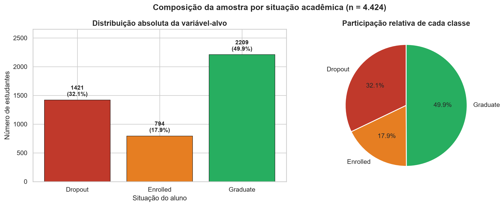
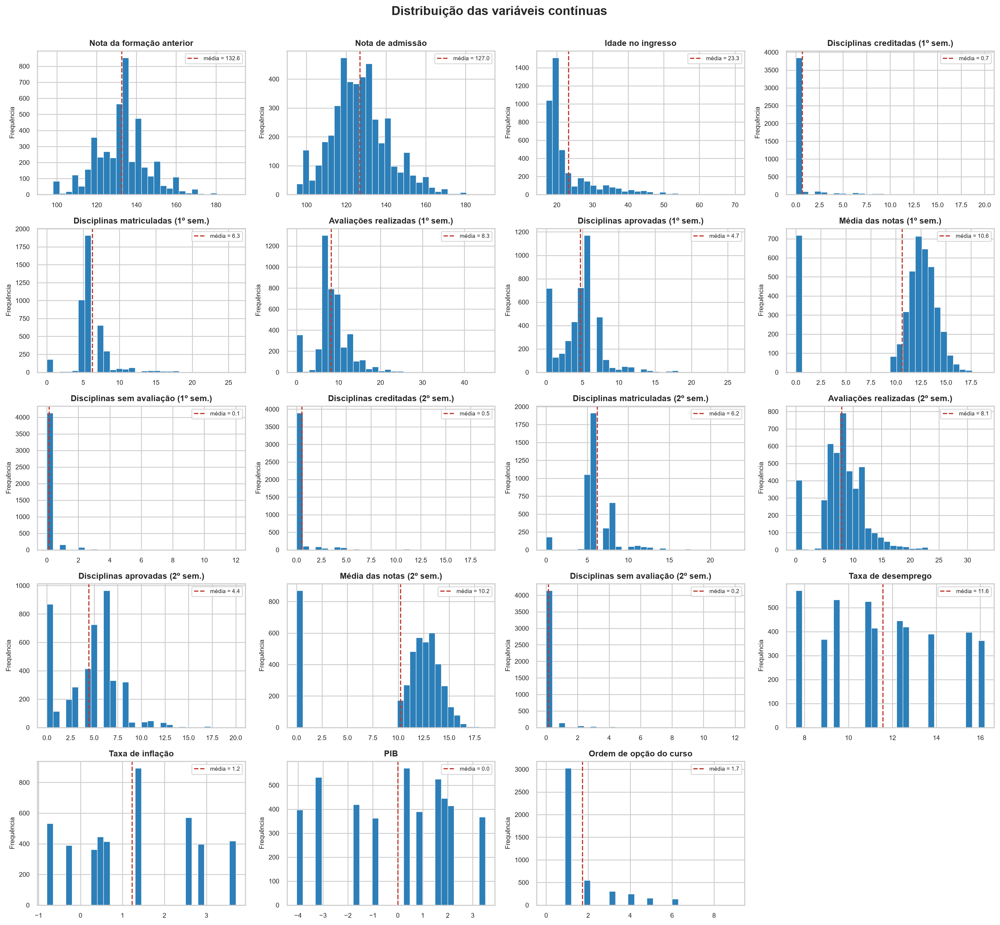
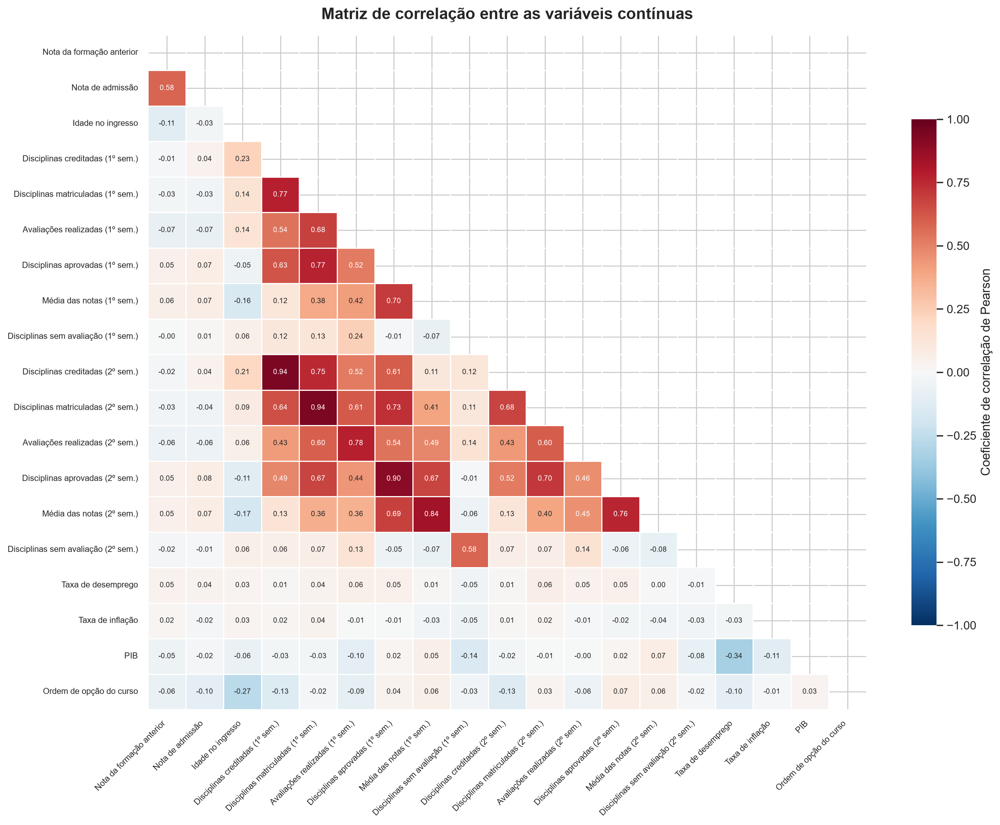
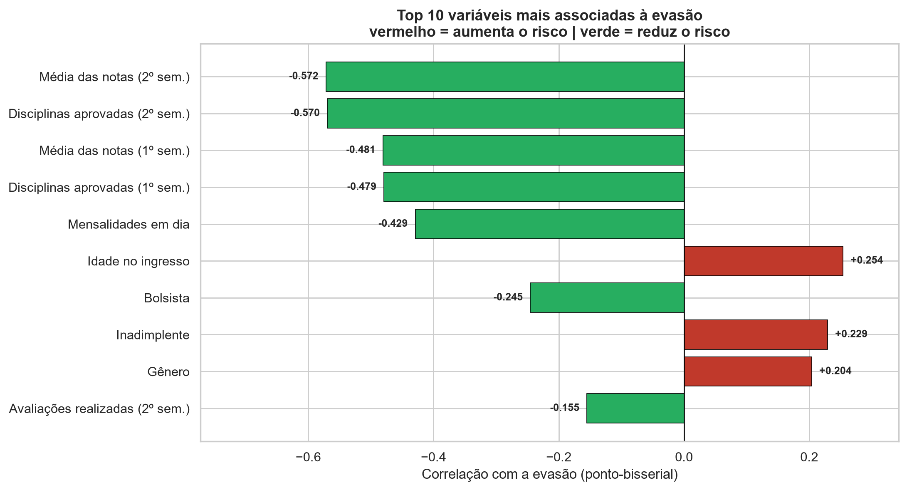
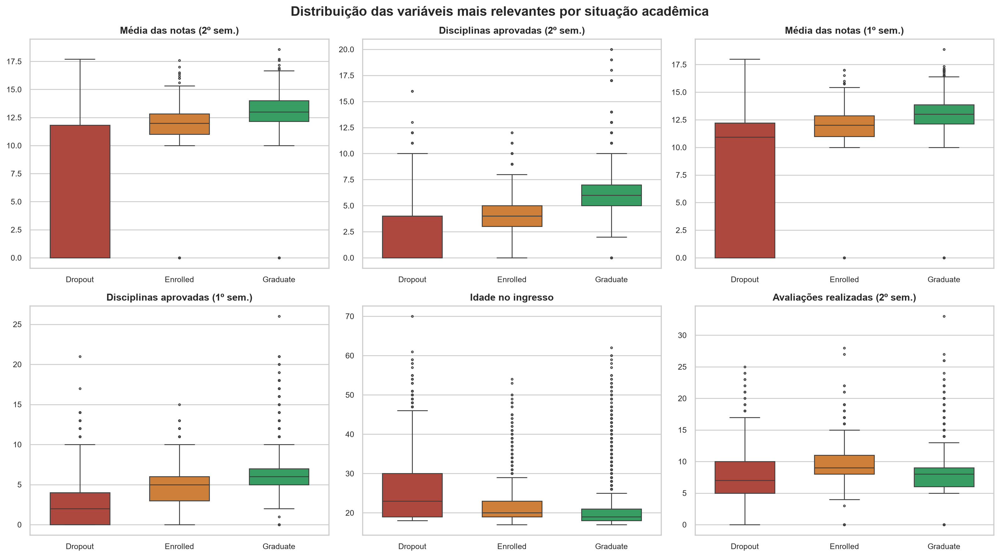

# 01 — Entendimento dos Dados (Fase 2 do CRISP-DM)

> **Notebook:** `01_analise_exploratoria.ipynb` (48 células — 24 de código, 24 de markdown)
> **Fonte:** MySQL `tcc.data`, com fallback para UCI id=697
> **Saída:** `dados/dataset_limpo.csv` (4.424 × 37) + figuras 01–05

---

## 1. Objetivo desta fase

Responder a três perguntas antes de qualquer modelagem:

1. **Os dados são confiáveis?** — completude, duplicatas, tipos, faixas válidas
2. **O que cada variável significa e como deve ser tratada?** — tipologia
3. **Existe sinal preditivo aqui?** — associação entre variáveis e evasão

A terceira pergunta é a mais importante para o desenho do trabalho. Se não houvesse sinal, nenhum
algoritmo o inventaria; e se o sinal fosse trivialmente forte, o trabalho seria pouco relevante. A
resposta encontrada — sinal forte, concentrado em poucas variáveis — determinou as escolhas de todas
as fases seguintes.

---

## 2. Carga e o problema da tipologia

### 2.1 A aparência enganosa de "tudo numérico"

O `df.dtypes` do dataset mostra 29 colunas `int64` e 7 `float64` — aparentemente todas numéricas.
Essa leitura é **falsa e perigosa**. Boa parte das colunas inteiras são **códigos de categoria**:

```
course = 171    → Enfermagem
course = 9254   → Gestão
course = 9070   → Design de Comunicação
```

O código `9254` não é "maior" nem "melhor" que `171`; são cursos diferentes. Tratá-los como
grandezas contínuas ensinaria ao modelo uma ordenação que não existe no mundo real, e produziria
divisões de árvore sem sentido do tipo "curso > 4500".

### 2.2 Solução: classificação explícita das colunas

O módulo `src/data_loader.py` classifica cada coluna em três grupos, através da função `tipologia()`:

| Grupo | Nº | Tratamento posterior | Colunas |
|---|---:|---|---|
| **Contínuas / ordinais** | 19 | `StandardScaler` | notas (1º e 2º sem.), disciplinas creditadas/matriculadas/avaliadas/aprovadas/sem avaliação, nota de admissão, nota da formação anterior, idade no ingresso, ordem de opção do curso, taxa de desemprego, taxa de inflação, PIB |
| **Binárias** | 8 | mantidas em 0/1 | turno, deslocado, necessidades especiais, inadimplente, mensalidades em dia, gênero, bolsista, internacional |
| **Nominais (códigos)** | 9 | `OneHotEncoder` | estado civil, modalidade de ingresso, curso, formação anterior, nacionalidade, escolaridade da mãe/pai, ocupação da mãe/pai |

`application_order` (ordem de opção do curso, de 1ª a 9ª) foi classificada como **ordinal e tratada
como numérica**: aqui a ordenação é real e informativa — quem entrou na 1ª opção escolheu o curso,
quem entrou na 6ª aceitou o que sobrou.

> **Por que isto é uma decisão e não um detalhe:** essa classificação foi feita manualmente, com base
> na documentação de Realinho et al. (2022), e não por inferência automática de tipo. Nenhuma
> biblioteca distinguiria `course=9254` de `age=23` — ambos são inteiros. Automatizar essa etapa
> exigiria heurísticas (cardinalidade, distribuição) que erram justamente nos casos ambíguos.

---

## 3. Qualidade dos dados

| Verificação | Resultado |
|---|---|
| Valores ausentes | **0** em todas as 4.424 linhas e 37 colunas |
| Registros integralmente duplicados | **0** |
| Colunas constantes (variância zero) | **nenhuma** |

Esse resultado é coerente com a descrição dos autores: o dataset foi pré-tratado antes da publicação,
com remoção de inconsistências e anomalias.

### Duas implicações opostas

**A favor:** não é necessária nenhuma estratégia de imputação (média, mediana, KNN), o que **elimina
uma fonte relevante de viés** e simplifica o pipeline.

**Contra — e isto precisa constar nas limitações:** o dataset é substancialmente mais limpo do que a
realidade de um sistema acadêmico brasileiro típico, onde faltam notas, há matrículas duplicadas e
campos socioeconômicos em branco. Um modelo treinado nestas condições **não foi exposto ao problema
de dados faltantes** e precisaria de tratamento adicional antes de qualquer implantação real.

### Alerta importante

**Ausência de nulos não é sinônimo de qualidade.** Esta mesma fase encontrou uma falha grave de
integridade que passou por todas as verificações acima sem gerar sintoma. Ela está documentada em
[02 — Qualidade e integridade](02-qualidade-e-integridade.md) e é, provavelmente, o achado
metodológico mais relevante desta etapa.

---

## 4. Distribuição da variável-alvo



| Classe | n | % |
|---|---:|---:|
| `Graduate` | 2.209 | 49,9% |
| `Dropout` | **1.421** | **32,1%** |
| `Enrolled` | 794 | 17,9% |

**Razão de desbalanceamento:** 2,78 : 1 (maior classe / menor classe).

### Consequências registradas

1. **A acurácia é inadequada como métrica principal.** Um classificador que respondesse sempre
   "Graduate" alcançaria 49,9% de acurácia sem identificar nenhum aluno em risco. O trabalho adota
   **F1-score e recall da classe `Dropout`**.
2. **O desbalanceamento justifica balanceamento no treino** — implementado com SMOTE na Fase 3,
   exclusivamente sobre o conjunto de treino.
3. **A taxa de evasão de 32,1% é alta**, e coerente com a literatura sobre evasão no ensino superior
   europeu. Não é um artefato de amostragem.

---

## 5. Distribuição das variáveis numéricas



### Achados

| Variável | Observação |
|---|---|
| **Notas semestrais (1º e 2º)** | Distribuição **bimodal**: uma massa concentrada em zero e outra em torno de 12–13. O zero não é erro — é o aluno que não completou nenhuma avaliação, geralmente já em processo de abandono |
| **Idade no ingresso** | Assimétrica à direita: média 23,3 anos, mediana 20, faixa de 17 a **70**. Há uma população não tradicional relevante |
| **Nota de admissão** | Aproximadamente normal — média 127,0, faixa observada de 95,0 a 190,0 (escala 0–200) |
| **Variáveis macroeconômicas** | Poucos valores distintos — refletem o ano de ingresso, não o indivíduo (ver seção 8) |

> A bimodalidade das notas é o achado mais importante desta seção. Ela indica que **a variável
> "média de notas" carrega dois sinais diferentes**: entre alunos ativos, mede desempenho; entre
> alunos em abandono, funciona como indicador binário de ausência. Isso explica em parte a alta
> capacidade preditiva dessas variáveis observada na Fase 4.

---

## 6. Correlação



### 6.1 Multicolinearidade entre semestres

| Par de variáveis | r |
|---|---:|
| Disciplinas creditadas (1º sem.) × (2º sem.) | **+0,945** |
| Disciplinas matriculadas (1º sem.) × (2º sem.) | **+0,943** |
| Disciplinas aprovadas (1º sem.) × (2º sem.) | **+0,904** |
| Média das notas (1º sem.) × (2º sem.) | **+0,837** |

Quatro pares com |r| ≥ 0,80, todos entre a mesma variável medida em semestres consecutivos — o que é
esperado, já que a carga curricular é semelhante e o desempenho do aluno é persistente.

**Consequência para a modelagem:** sob multicolinearidade dessa magnitude, os **coeficientes da
Regressão Logística ficam instáveis** — o modelo continua predizendo bem, mas a leitura de "quanto
cada variável pesa individualmente" perde confiabilidade, porque o peso pode migrar arbitrariamente
entre variáveis quase idênticas. Modelos de árvore são imunes ao problema de estimação, mas
distribuem a importância entre as variáveis correlacionadas, diluindo-a.

Esta é uma das razões pelas quais **a interpretabilidade final do trabalho vem do SHAP e não dos
coeficientes** do modelo linear.

### 6.2 As 10 variáveis mais associadas à evasão



Correlação ponto-bisserial com a variável auxiliar `is_dropout` (1 = evadiu, 0 = caso contrário):

| # | Variável | r | Direção |
|---:|---|---:|---|
| 1 | Média das notas (2º sem.) | **−0,572** | ↓ nota → ↑ risco |
| 2 | Disciplinas aprovadas (2º sem.) | **−0,570** | ↓ aprovações → ↑ risco |
| 3 | Média das notas (1º sem.) | −0,481 | ↓ nota → ↑ risco |
| 4 | Disciplinas aprovadas (1º sem.) | −0,479 | ↓ aprovações → ↑ risco |
| 5 | Mensalidades em dia | **−0,429** | inadimplência → ↑ risco |
| 6 | Idade no ingresso | **+0,254** | ↑ idade → ↑ risco |
| 7 | Bolsista | −0,245 | bolsa → ↓ risco |
| 8 | Inadimplente | +0,229 | dívida → ↑ risco |
| 9 | Gênero | +0,204 | (código 1 = masculino) → ↑ risco |
| 10 | Avaliações realizadas (2º sem.) | −0,155 | ↓ avaliações → ↑ risco |

> **Nota metodológica:** a variável auxiliar `is_dropout` foi criada **apenas para esta análise
> descritiva** e não entra em nenhum conjunto de treino. Sua presença nas features seria vazamento
> direto do alvo.

### Interpretação

Os dez fatores se organizam em **três blocos**, e essa organização se manteve em todas as análises
posteriores (informação mútua, importância por impureza e — a confirmar — SHAP):

1. **Desempenho acadêmico** (posições 1–4, 10) — o bloco dominante, com as correlações mais fortes
2. **Situação financeira** (posições 5, 7, 8) — mensalidades, bolsa e inadimplência
3. **Perfil demográfico** (posições 6, 9) — idade e gênero

O bloco financeiro merece destaque: é **acionável por política institucional**. Diferente da idade ou
do histórico escolar prévio, a inadimplência é algo sobre o que a instituição pode agir diretamente
(renegociação, bolsa emergencial, auxílio permanência).

---

## 7. Comportamento das variáveis por classe



### Medianas por situação acadêmica

| Variável | `Dropout` | `Enrolled` | `Graduate` |
|---|---:|---:|---:|
| Disciplinas aprovadas (2º sem.) | **0,0** | 4,0 | 6,0 |
| Média das notas (2º sem.) | **0,0** | 12,0 | 13,0 |
| Disciplinas aprovadas (1º sem.) | 2,0 | 5,0 | 6,0 |
| Média das notas (1º sem.) | 10,9 | 12,0 | 13,0 |
| Idade no ingresso | 23,0 | 20,0 | 19,0 |
| Nota de admissão | 123,6 | 124,1 | 127,4 |

### Dois achados decisivos

**1. Separabilidade extrema no 2º semestre.** A mediana de disciplinas aprovadas é **0 para quem
evade** e **6 para quem se forma**. Não é uma diferença de grau — é uma diferença de natureza. O aluno
que evade tipicamente **para de aprovar disciplinas antes de formalizar a saída**, e essa parada é
visível nos dados.

**2. `Enrolled` fica sistematicamente no meio.** Em todas as variáveis, a mediana de `Enrolled` cai
**entre** as de `Dropout` e `Graduate`, sem ocupar região própria. É exatamente o padrão esperado de
um rótulo que **mistura futuros formandos com futuros evadidos** — a evidência empírica que sustentou
a decisão de removê-lo na Fase 3 (ver [03 — Preparação dos dados](03-preparacao-dos-dados.md), §2).

### Taxa de evasão por variável binária

Calculada sobre as três classes (taxa-base de referência: **32,1%**):

| Variável | Valor 0 | Valor 1 | Diferença |
|---|---:|---:|---:|
| **Mensalidades em dia** | 86,6% | 24,7% | **−61,8 pp** |
| **Inadimplente** | 28,3% | 62,0% | **+33,7 pp** |
| **Bolsista** | 38,7% | 12,2% | **−26,5 pp** |
| Gênero | 25,1% | 45,1% | +19,9 pp |
| Turno (diurno/noturno) | 42,9% | 30,8% | −12,1 pp |
| Deslocado da cidade de origem | 37,6% | 27,6% | −10,1 pp |
| Estudante internacional | 32,2% | 29,1% | −3,1 pp |
| Necessidades educacionais especiais | 32,1% | 33,3% | +1,2 pp |

**O número mais expressivo de toda a análise exploratória:** entre alunos com mensalidades **em
atraso**, a taxa de evasão é de **86,6%** — contra 24,7% entre os que estão em dia. Uma diferença de
62 pontos percentuais em uma única variável binária.

Igualmente notável: **bolsistas evadem a 12,2%**, contra 38,7% dos não bolsistas — menos de um terço
do risco. Esses dois números, juntos, constituem o argumento empírico mais forte do trabalho a favor
de **políticas de assistência estudantil como instrumento de retenção**.

Em contrapartida, `educational_special_needs` (+1,2 pp) e `international` (−3,1 pp) praticamente não
discriminam. Foram **mantidas no modelo** — ver justificativa em
[03 — Preparação dos dados](03-preparacao-dos-dados.md), §7.

---

## 8. Variáveis macroeconômicas: uma ressalva conceitual

`unemployment_rate`, `inflation_rate` e `gdp` têm poucos valores distintos, porque descrevem o
**contexto econômico do ano de ingresso**, não o indivíduo.

Isso significa que, na prática, elas funcionam como um **identificador aproximado da coorte de
ingresso**. O modelo pode usá-las para "descobrir o ano" e explorar diferenças de taxa de evasão entre
coortes — o que é um sinal real, mas **não generaliza para anos futuros**, cujos valores
macroeconômicos serão diferentes de todos os observados no treino.

**Decisão:** mantidas, porque removê-las sem evidência seria seleção arbitrária, e porque sua
importância medida na Fase 3 é baixa (PIB e inflação ficam abaixo de 1,5% de importância). Mas a
ressalva fica registrada como limitação de generalização temporal.

---

## 9. Análise de outliers (método IQR)

Critério: valor fora de [Q1 − 1,5·IQR, Q3 + 1,5·IQR].

| Variável | Outliers | % |
|---|---:|---:|
| Média das notas (2º sem.) | 877 | 19,8% |
| Média das notas (1º sem.) | 726 | 16,4% |
| Disciplinas creditadas (1º sem.) | 577 | 13,0% |
| Ordem de opção do curso | 541 | 12,2% |
| Disciplinas creditadas (2º sem.) | 530 | 12,0% |
| Idade no ingresso | 441 | 10,0% |
| Disciplinas matriculadas (1º sem.) | 424 | 9,6% |
| Disciplinas matriculadas (2º sem.) | 369 | 8,3% |
| Disciplinas sem avaliação (1º sem.) | 294 | 6,6% |
| Disciplinas sem avaliação (2º sem.) | 282 | 6,4% |

**Registros com ao menos um outlier: 2.422 (54,7% da amostra).**

### A decisão de manter todos os outliers

| | Taxa de evasão |
|---|---:|
| Registros **com** ao menos um outlier | **45,7%** |
| Registros **sem** nenhum outlier | **15,6%** |
| **Diferença** | **+30,1 pontos percentuais** |

Este é o teste que resolveu a questão. Se os outliers fossem ruído de medição, sua taxa de evasão
seria semelhante à do resto da amostra. Ela é **três vezes maior**.

> **Os outliers não são ruído — são o sinal.** O aluno com nota zero no semestre, o ingressante de 60
> anos, o aluno que se matriculou em 20 disciplinas: são exatamente os casos atípicos que o modelo
> precisa aprender a reconhecer. Removê-los ou winsorizá-los **destruiria a capacidade preditiva** e,
> pior, removeria preferencialmente os alunos em risco — precisamente a população-alvo do trabalho.

**Decisão: nenhum registro removido, nenhum valor truncado.** Os 4.424 registros seguem para a Fase 3.

Que a mediana de notas do 2º semestre seja **0** para a classe `Dropout` (§7) confirma o raciocínio
por outra via: o "outlier" é o comportamento **típico** de quem evade.

---

## 10. Síntese da Fase 2

### O que foi estabelecido

| Pergunta | Resposta |
|---|---|
| Os dados estão completos? | Sim — 0 nulos, 0 duplicatas, 0 colunas constantes |
| Os dados estão íntegros? | **Não na origem** — falha corrigida e auditada (ver [doc 02](02-qualidade-e-integridade.md)) |
| Existe sinal preditivo? | **Sim, forte** — r até −0,572; separabilidade quase total no 2º semestre |
| Onde está o sinal? | Desempenho acadêmico > situação financeira > perfil demográfico |
| Há multicolinearidade? | Sim, r até 0,945 entre semestres — limita a leitura de coeficientes lineares |
| Os outliers são problema? | Não — são o próprio sinal (evasão 45,7% vs 15,6%) |

### Decisões tomadas nesta fase

| Decisão | Justificativa |
|---|---|
| Classificar colunas em contínuas / binárias / nominais manualmente | Códigos inteiros não são grandezas; inferência automática de tipo erraria |
| **Não** remover outliers | Sua taxa de evasão é 3× maior — são sinal, não ruído |
| **Não** imputar nada | Não há valores ausentes |
| **Não** remover variáveis macroeconômicas | Removê-las sem evidência seria arbitrário; ressalva registrada |
| Manter as 4.424 linhas e 37 colunas | Nenhum critério justificou descarte nesta fase |
| Corrigir as notas corrompidas na carga | Domínio da variável torna a correção determinística; auditada contra a fonte oficial |

### Encaminhamentos para a Fase 3

1. **Tratar a classe `Enrolled`** — a evidência de que ela não tem região própria aponta para remoção
2. **Codificar as 9 nominais** sem introduzir ordenação falsa
3. **Padronizar as 19 contínuas** — escalas de 0–20, 17–70 e −4 a 4 são incompatíveis
4. **Balancear o treino** — razão 2,78:1 exige correção
5. **Registrar a multicolinearidade** como limitação da Regressão Logística
