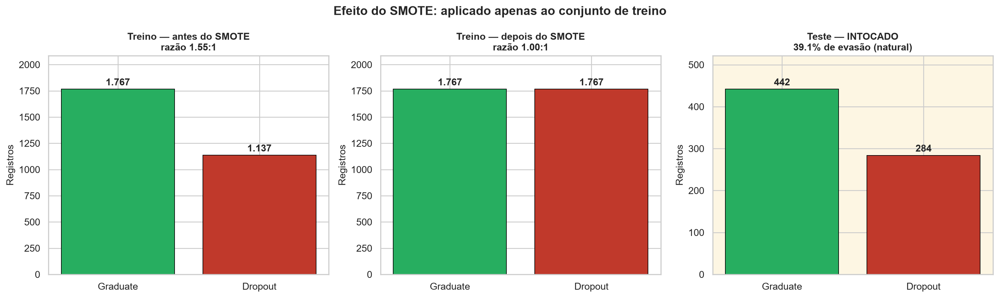
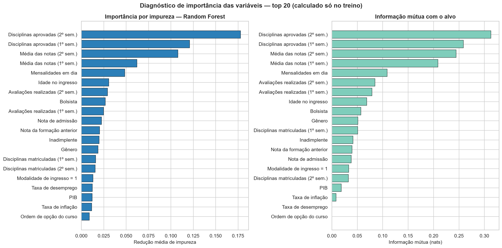

# 03 — Preparação dos Dados (Fase 3 do CRISP-DM)

> **Notebook:** `02_preprocessamento.ipynb` (27 células — 15 de código, 12 de markdown)
> **Entrada:** `dados/dataset_limpo.csv` (4.424 × 37)
> **Saídas:** 6 CSVs + `metadados.json` + `modelos/preprocessador.joblib` + figuras 06–07

---

## 1. Objetivo e princípio organizador

Transformar o conjunto auditado na Fase 2 em matrizes prontas para treinamento, **sem introduzir
vazamento de informação**.

Todo o notebook é organizado por um único princípio:

> **Nada que dependa dos dados pode ser aprendido antes da separação treino/teste.**

Média e desvio-padrão do `StandardScaler`, categorias do `OneHotEncoder` e vizinhos sintéticos do
SMOTE são **parâmetros estimados a partir dos dados**. Se calculados sobre o conjunto completo, o
modelo recebe indiretamente informação do teste e a métrica final fica otimista.

A ordem é, portanto, rígida: **separar → ajustar no treino → aplicar no teste**.

---

## 2. Tratamento da classe `Enrolled`

### 2.1 O problema conceitual

`Enrolled` designa o aluno que, **na data de corte da coleta, ainda estava matriculado**. Não é um
desfecho — é a **ausência de desfecho**. Esse aluno pode vir a se formar ou a evadir depois; o rótulo
apenas registra que o acompanhamento terminou antes do fim da trajetória.

Em análise de sobrevivência isso se chama **censura à direita**. Tratar `Enrolled` como uma terceira
categoria equivale a afirmar que "continuar matriculado" é um resultado final, o que é falso.

### 2.2 A evidência empírica

A Fase 2 já havia mostrado a consequência prática (ver [01](01-entendimento-dos-dados.md), §7): em
todas as variáveis acadêmicas, a mediana de `Enrolled` cai **entre** as de `Dropout` e `Graduate`, sem
região própria.

| Variável | `Dropout` | `Enrolled` | `Graduate` |
|---|---:|---:|---:|
| Disciplinas aprovadas (2º sem.) | 0,0 | **4,0** | 6,0 |
| Média das notas (2º sem.) | 0,0 | **12,0** | 13,0 |
| Idade no ingresso | 23,0 | **20,0** | 19,0 |

É exatamente o padrão esperado de um rótulo que **mistura futuros formandos com futuros evadidos**: a
classe não tem fronteira nítida porque não corresponde a um fenômeno único.

### 2.3 Decisão

**Formulação binária** (`Dropout` × `Graduate`), com `Enrolled` removido. Quatro justificativas:

| # | Justificativa |
|---|---|
| 1 | **Coerência semântica** — compara-se desfecho com desfecho |
| 2 | **Alinhamento com a literatura** — é a formulação predominante nos trabalhos que usam esta base, o que permite comparar resultados |
| 3 | **Utilidade prática** — o produto de interesse da gestão é uma probabilidade de evasão, e a decisão de intervir é binária |
| 4 | **Interpretabilidade** — os valores SHAP são muito mais legíveis com uma saída ("empurra para evasão" × "empurra para conclusão") do que com três |

### 2.4 A alternativa multiclasse permanece implementada

Ambas as opções estão codificadas no notebook. A troca é feita em **uma linha**:

```python
FORMULACAO = "binaria"      # ou "multiclasse"
```

Os artefatos da versão multiclasse recebem o sufixo `_multiclasse` nos nomes de arquivo, sem
sobrescrever os da versão binária. Isso permite reportar a multiclasse como **análise de
sensibilidade** na monografia sem refazer o pipeline.

### 2.5 Limitação decorrente — a mais importante desta fase

> Ao remover `Enrolled`, o modelo passa a ser treinado e validado **apenas em trajetórias
> concluídas**. Em produção, porém, ele seria aplicado justamente sobre **alunos ativos** — a população
> excluída do treino.
>
> Há, portanto, uma diferença estrutural entre a população de treino e a população de aplicação. Isso
> **precisa constar nas limitações** e é o principal candidato a trabalho futuro: modelagem de
> sobrevivência com dados censurados (Cox, Kaplan-Meier, *random survival forests*), que trata
> `Enrolled` corretamente em vez de descartá-lo.

### Resultado do recorte

| | |
|---|---|
| Registros | 4.424 → **3.630** (−794) |
| `Graduate` (código 0) | 2.209 — 60,9% |
| `Dropout` (código 1) | 1.421 — 39,1% |
| Razão de desbalanceamento | 2,78:1 → **1,55:1** |

---

## 3. Classe positiva e métrica de avaliação

`Dropout` é codificado como **classe positiva (1)**. A razão não é estatística, é de **custo
assimétrico**:

> Os dois erros possíveis **não custam a mesma coisa**. Deixar de sinalizar um aluno que vai evadir
> (falso negativo) significa perder a única chance de intervir. Sinalizar um aluno que não evadiria
> (falso positivo) custa o tempo de uma conversa da coordenação.

Por isso o trabalho é avaliado por **recall e F1-score da classe positiva**, e não por acurácia. Um
modelo que classificasse todos como `Graduate` já alcançaria **60,9% de acurácia** sem identificar
nenhum aluno em risco — esse é o piso trivial que a acurácia esconde.

---

## 4. Separação treino/teste

**Primeira operação sobre os dados**, antes de qualquer transformação.

```python
X_treino_bruto, X_teste_bruto, y_treino, y_teste = train_test_split(
    X, y, test_size=0.20, random_state=42, stratify=y,
)
```

| Conjunto | Registros | % | Taxa de evasão |
|---|---:|---:|---:|
| Treino | 2.904 | 80% | 0,3915 |
| Teste | 726 | 20% | 0,3912 |

`stratify=y` preserva a taxa de evasão nos dois lados. Sem isso, o acaso poderia produzir um teste com
composição diferente da do treino, tornando a métrica final ininterpretável. A diferença entre as duas
proporções é de 0,0003 — a estratificação foi verificada programaticamente no notebook.

**A partir deste ponto, `X_test` fica intocado** até a avaliação final da Fase 4.

---

## 5. Codificação e padronização

### 5.1 Tratamento por grupo

| Grupo | Nº | Tratamento | Por quê |
|---|---:|---|---|
| **Contínuas** | 19 | `StandardScaler` | Notas (0–20), idade (17–70) e PIB (−4 a 4) têm escalas incompatíveis; a Regressão Logística é sensível a isso |
| **Binárias** | 8 | mantidas como estão | Já são 0/1; padronizar só dificultaria a leitura dos coeficientes |
| **Nominais** | 9 | `OneHotEncoder` | Elimina a falsa ordenação entre códigos de categoria |

### 5.2 O problema da cardinalidade

Contagem feita **apenas no treino**:

| Variável nominal | Categorias | Abaixo de 1% |
|---|---:|---:|
| Ocupação do pai | 39 | 27 |
| Escolaridade do pai | 31 | 24 |
| Ocupação da mãe | 29 | 19 |
| Escolaridade da mãe | 27 | 20 |
| Nacionalidade | 18 | 17 |
| Modalidade de ingresso | 17 | 8 |
| Curso | 17 | 1 |
| Formação anterior | 16 | 12 |
| Estado civil | 6 | 3 |
| **Total** | **200** | **131** |

Um one-hot ingênuo geraria **200 colunas**, das quais 131 estariam ativas em menos de 1% dos alunos —
ruído que modelos de árvore memorizam com facilidade.

### 5.3 Solução: `min_frequency=0.01`

```python
OneHotEncoder(
    min_frequency=0.01,                      # agrupa categorias com <1% do treino
    handle_unknown="infrequent_if_exist",    # robusto a categoria nova no teste
    sparse_output=False,
)
```

Categorias com menos de 1% de presença no treino são agrupadas em `infrequent_sublevel`. Três
benefícios:

1. Preserva as categorias com sustentação estatística
2. Controla a dimensionalidade: **200 → 78 dummies**
3. A regra é **aprendida apenas no treino** — uma categoria rara que apareça só no teste cai no grupo
   residual em vez de quebrar a transformação

> **Isto não é seleção de variáveis.** Nenhuma variável é descartada. O que se agrupa são
> **categorias raras dentro de** uma variável que permanece no modelo.

### 5.4 Resultado

```python
preprocessador = ColumnTransformer([
    ("cont", StandardScaler(), COLS_CONTINUAS),
    ("bin",  "passthrough",    COLS_BINARIAS),
    ("nom",  OneHotEncoder(...), COLS_NOMINAIS),
], remainder="drop", verbose_feature_names_out=False)

preprocessador.fit(X_treino_bruto)     # AJUSTE SOMENTE NO TREINO
```

| | |
|---|---|
| Colunas originais | 36 |
| **Features finais** | **105** |
| — contínuas padronizadas | 19 |
| — binárias mantidas | 8 |
| — dummies geradas | 78 (de 200 categorias possíveis) |

### 5.5 Verificação do não vazamento

Uma célula do notebook comprova que o scaler foi ajustado só no treino:

```
treino -> média +0.000000 | desvio 1.000000
teste  -> média -0.022141 | desvio 0.981818
```

> Se a padronização tivesse sido ajustada no conjunto completo, o **teste também** teria média 0 e
> desvio 1. O pequeno desvio observado é a **evidência positiva** de que isso não ocorreu. É uma
> verificação simples que transforma uma afirmação metodológica em fato observável.

---

## 6. Balanceamento com SMOTE

### 6.1 Motivação

O treino tem 1.137 evasões contra 1.767 conclusões. Sem correção, o critério de erro dos algoritmos
favorece a classe majoritária: acertar `Graduate` reduz mais a perda total do que acertar `Dropout` —
justamente o oposto do que interessa.

**SMOTE** (*Synthetic Minority Over-sampling Technique*, Chawla et al., 2002) equilibra as classes
criando exemplos sintéticos da minoritária: cada novo ponto é sorteado sobre o segmento que liga um
aluno evadido a um de seus *k* vizinhos mais próximos da mesma classe (aqui, `k_neighbors=5`).
Diferentemente da duplicação simples, isso **amplia a região de decisão** em vez de apenas repetir
pontos.

### 6.2 Por que exclusivamente no treino

> Aplicar SMOTE antes da separação é um dos erros mais frequentes — e mais graves — em trabalhos
> aplicados. Um ponto sintético é interpolado a partir de alunos reais; se ele for para o treino
> enquanto seus "pais" ficam no teste, o modelo terá visto uma **versão borrada dos registros de
> teste**. A métrica resultante mede memorização, não generalização.

### 6.3 Resultado



| | Antes | Depois | Sintéticos |
|---|---:|---:|---:|
| `Graduate` | 1.767 | 1.767 | 0 |
| `Dropout` | 1.137 | **1.767** | **+630** |
| **Total** | 2.904 | **3.534** | 630 |
| Razão | 1,55:1 | **1,00:1** | — |

**O conjunto de teste permanece com 726 registros e 39,1% de evasão** — a proporção natural que o
modelo encontraria na prática. O painel destacado à direita da figura documenta visualmente esse fato.

> **Nenhuma métrica reportada neste trabalho é calculada sobre dados sintéticos.**

### 6.4 Ressalva metodológica registrada

A interpolação atua sobre as *dummies* já codificadas e pode gerar valores fracionários onde só
existiriam 0 ou 1 (por exemplo, 0,34 em `course_9500`).

A alternativa **`SMOTENC`**, que trata colunas categóricas de forma discreta, foi considerada.
Optou-se pelo **SMOTE clássico** por ser o procedimento predominante na literatura desta base, o que
preserva a comparabilidade dos resultados. O efeito prático é pequeno porque as dummies representam
parcela menor da variância — mas a ressalva fica registrada como limitação.

### 6.5 Nota sobre a Fase 4

Este conjunto balanceado **não é usado diretamente na validação cruzada** da Fase 4. Fazer isso
vazaria informação entre as dobras. Por essa razão, o notebook salva **as duas versões** do treino —
com e sem SMOTE. Ver [04 — Modelagem](04-modelagem.md), §2.

---

## 7. Diagnóstico de importância das variáveis

Duas medidas complementares, ambas calculadas **somente sobre o treino**:

- **Informação mútua** (`mutual_info_classif`) — dependência estatística entre cada variável e o alvo,
  inclusive não linear, avaliando uma variável de cada vez
- **Importância por impureza** (Random Forest preliminar, 300 árvores) — contribuição de cada variável
  para as divisões das árvores, já considerando interação com as demais

### 7.1 Top 15



| # | Variável | Info. mútua | Import. RF | rank MI |
|---:|---|---:|---:|---:|
| 1 | Disciplinas aprovadas (2º sem.) | 0,3130 | **0,1778** | 1 |
| 2 | Disciplinas aprovadas (1º sem.) | 0,2587 | 0,1210 | 2 |
| 3 | Média das notas (2º sem.) | 0,2444 | 0,1078 | 3 |
| 4 | Média das notas (1º sem.) | 0,2088 | 0,0621 | 4 |
| 5 | Mensalidades em dia | 0,1087 | 0,0486 | 5 |
| 6 | Idade no ingresso | 0,0688 | 0,0307 | 8 |
| 7 | Avaliações realizadas (2º sem.) | 0,0849 | 0,0293 | 6 |
| 8 | Bolsista | 0,0572 | 0,0268 | 9 |
| 9 | Avaliações realizadas (1º sem.) | 0,0790 | 0,0249 | 7 |
| 10 | Nota de admissão | 0,0383 | 0,0225 | 14 |
| 11 | Nota da formação anterior | 0,0400 | 0,0204 | 13 |
| 12 | Inadimplente | 0,0416 | 0,0198 | 12 |
| 13 | Gênero | 0,0514 | 0,0187 | 10 |
| 14 | Disciplinas matriculadas (1º sem.) | 0,0509 | 0,0159 | 11 |
| 15 | Disciplinas matriculadas (2º sem.) | 0,0326 | 0,0155 | 16 |

### 7.2 Concentração da importância

| | |
|---|---|
| Top 5 features | 51,7% da importância total |
| Top 10 | 65,2% |
| Top 20 | 80,0% |
| Top 40 | 89,2% |
| Features com importância < 0,1% | 19 de 105 |

### 7.3 Por que nada foi descartado

O modelo final precisa ser **interpretável**, e interpretabilidade não é sinônimo de parcimônia. Três
argumentos:

1. **Uma variável com importância baixa no agregado pode ser decisiva para um subgrupo específico** —
   e é exatamente esse tipo de leitura individual que o SHAP entrega na Fase 5. Descartar por média é
   incompatível com explicação por indivíduo.
2. **Não há restrição computacional.** Com 2.904 observações de treino e 105 features, todos os modelos
   treinam em menos de 1 segundo.
3. **Seleção agressiva sem justificativa é uma decisão arbitrária** que a banca pode questionar
   legitimamente.

Esta seção é, portanto, **diagnóstica**: antecipa o que o SHAP deve confirmar e detecta variáveis
suspeitas de vazamento.

### 7.4 Três leituras

1. **Confirma a Fase 2 por caminhos independentes.** Lá a evidência era correlação linear; aqui é
   dependência não linear (informação mútua) e ganho em partições de árvore. **Achados que sobrevivem a
   métodos diferentes são os que se sustentam na defesa.**
2. **Nenhuma variável tem importância anômala.** Um preditor isolado que dominasse todos os outros
   seria sinal de vazamento — não é o caso: a maior importância individual é 17,8%, e a distribuição é
   plausível.
3. **As dummies aparecem pouco no topo**, o que era esperado — cada uma carrega uma fatia estreita da
   informação. Isso justifica *a posteriori* a decisão de agrupar categorias raras.

### 7.5 Alerta sobre a métrica de importância

> A importância por impureza é **enviesada em favor de variáveis com muitos valores distintos** e nada
> diz sobre a **direção** do efeito — ela informa que "idade importa", não se idade alta aumenta ou
> reduz o risco.
>
> É precisamente por essas duas limitações que o trabalho **não se apoia nela como resultado final**.
> O SHAP existe para corrigir ambas.

---

## 8. Artefatos gerados

| Arquivo | Dimensões | Conteúdo |
|---|---|---|
| `dados/X_train.csv` | 3.534 × 105 | Treino **após** SMOTE |
| `dados/y_train.csv` | 3.534 | Alvo correspondente (50/50) |
| `dados/X_train_sem_smote.csv` | 2.904 × 105 | Treino natural — **base da validação cruzada** |
| `dados/y_train_sem_smote.csv` | 2.904 | Alvo correspondente (39,1%) |
| `dados/X_test.csv` | 726 × 105 | Teste intocado |
| `dados/y_test.csv` | 726 | Alvo correspondente (39,1%) |
| `dados/metadados.json` | — | Formulação, classes, classe positiva, lista das 105 features, tipologia, contagens |
| `modelos/preprocessador.joblib` | — | `ColumnTransformer` ajustado no treino |

O `preprocessador.joblib` é necessário para transformar **qualquer aluno novo** exatamente como o
modelo espera — sem ele, o pipeline não é aplicável fora do notebook.

### Verificação de integridade

O notebook encerra com sete asserções que **abortam a execução** se qualquer uma falhar:

```
[OK] treino e alvo com o mesmo nº de linhas
[OK] teste e alvo com o mesmo nº de linhas
[OK] mesmas features em treino e teste
[OK] treino balanceado (razão = 1,00)
[OK] teste NÃO balanceado (proporção natural)
[OK] sem valores ausentes
[OK] sem valores infinitos
```

A quinta asserção é a mais importante: ela **falharia se o SMOTE tivesse contaminado o teste**. É a
tradução de uma afirmação metodológica em um teste automático.

---

## 9. Síntese da Fase 3

### Decisões e justificativas

| Decisão | Escolha | Justificativa central |
|---|---|---|
| Classe `Enrolled` | Removida (binária) | Não é desfecho, é censura à direita; sem fronteira empírica própria |
| Classe positiva | `Dropout` = 1 | Falso negativo é o erro caro; recall precisa ser da evasão |
| Separação | 80/20 estratificada, **primeiro passo** | Impede que qualquer parâmetro veja o teste |
| Contínuas | `StandardScaler` ajustado no treino | Escalas incompatíveis; exigido pela Regressão Logística |
| Binárias | Mantidas em 0/1 | Já padronizadas; preserva legibilidade dos coeficientes |
| Nominais | One-hot com `min_frequency=0,01` | Remove ordenação falsa e controla dimensionalidade (200 → 78) |
| Balanceamento | SMOTE só no treino | Sintético no teste inflaria a métrica |
| Seleção de variáveis | **Nenhuma** | Interpretabilidade exige o quadro completo; sem restrição computacional |

### Resultado

| | |
|---|---|
| Registros | 4.424 → **3.630** |
| Features | 36 colunas → **105** |
| Treino | 2.904 → **3.534** (630 sintéticos), razão 1,00:1 |
| Teste | **726** registros, 39,1% de evasão — intocado |

### Integridade metodológica

O SMOTE roda **depois** da separação; `StandardScaler` e `OneHotEncoder` são ajustados
**exclusivamente** no treino; o diagnóstico de importância também. Duas verificações transformam essas
afirmações em fatos observáveis: o desvio residual do teste após a padronização (§5.5) e as sete
asserções de integridade (§8).
