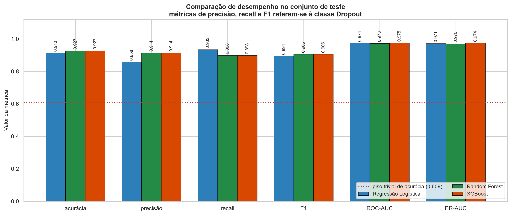
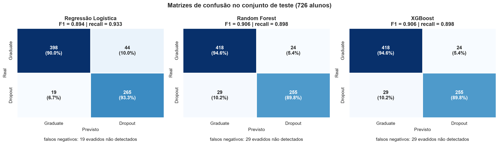
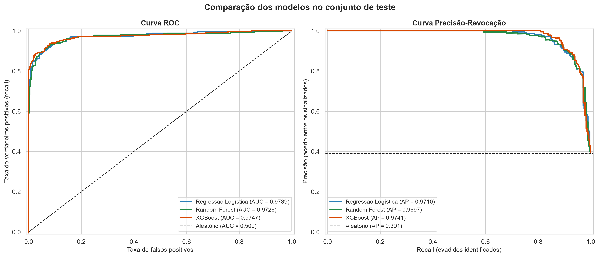
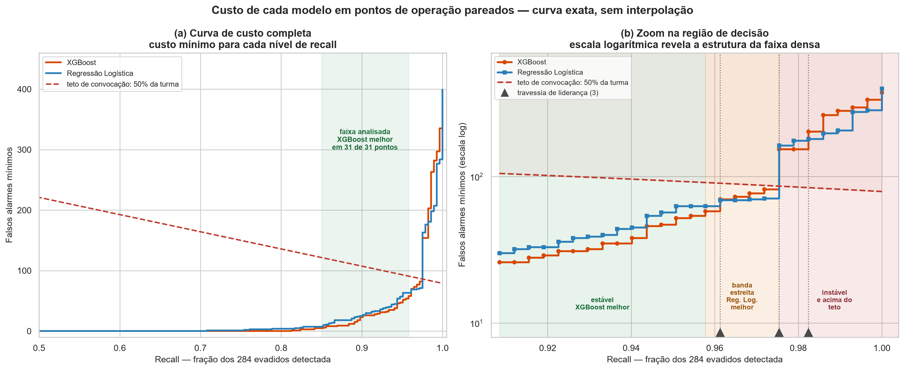
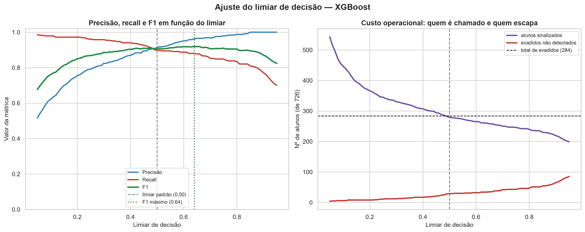

# 04 — Modelagem (Fase 4 do CRISP-DM)

> **Notebook:** `03_treinamento_modelos.ipynb` (50 células — 30 de código, 20 de markdown)
> **Entrada:** artefatos da Fase 3
> **Saídas:** 4 modelos `.joblib`, `metricas_modelos.csv`, `analise_limiar.csv`,
> `info_melhor_modelo.json`, figuras 08–11

> **Convenção de partição — vale para todas as tabelas deste documento.** Salvo indicação em
> contrário, todo número de desempenho vem da **partição da semente 42**. A
> [Verificação 2](10-significancia.md) mostrou que essa partição é **favorável**: em partições típicas
> o F1 é ≈ 0,88 (não 0,9059), o modelo detecta **84 de cada 100** evadidos (não 90, faixa 82–86) e
> perde 44 em vez de 29. A precisão não apresenta esse viés. **Comparações entre modelos permanecem
> válidas**, porque todos são avaliados sobre exatamente os mesmos alunos.

---

## 1. Objetivo e critério de decisão

Treinar, otimizar e comparar três algoritmos, selecionando um para a análise de interpretabilidade da
Fase 5.

| Modelo | Papel no trabalho |
|---|---|
| **Regressão Logística** | Linha de base — modelo linear, interpretável por construção |
| **Random Forest** | *Ensemble* de árvores por *bagging* |
| **XGBoost** | *Ensemble* por *gradient boosting*, estado da arte em dados tabulares |

A progressão é intencional: **se um modelo complexo não superar a linha de base linear de forma
relevante, a escolha correta é o modelo simples.** Complexidade precisa ser justificada por ganho
mensurável, e a Regressão Logística existe aqui exatamente para impor esse ônus da prova.

### Critério de seleção, declarado antes de ver os resultados

1. **F1-score da classe `Dropout`** (critério principal)
2. **Recall da classe `Dropout`** (primeiro desempate)
3. **PR-AUC** (segundo desempate)

O segundo desempate não é decorativo — foi necessário, como a §7 mostra.

---

## 2. Onde o SMOTE entra na validação cruzada

Este é o ponto metodológico mais delicado da fase.

### 2.1 A armadilha

O caminho intuitivo seria rodar a validação cruzada diretamente sobre o treino balanceado da Fase 3
(3.534 registros). **Estaria errado.**

Na validação cruzada, o treino é repartido em 5 dobras; a cada rodada, 4 servem para treinar e 1 para
validar. Se o SMOTE já foi aplicado ao conjunto inteiro, **pontos sintéticos interpolados a partir de
um aluno da dobra de validação estarão presentes nas dobras de treino**. O modelo valida contra
vizinhos dos próprios registros que viu, e a métrica de validação sai inflada.

É o mesmo raciocínio que justificou aplicar SMOTE só no treino na Fase 3, agora **um nível mais
abaixo**: dentro do treino, cada dobra precisa ser tratada como um teste em miniatura.

### 2.2 Solução: SMOTE dentro do pipeline

```python
from imblearn.pipeline import Pipeline as PipelineImb

def construir_pipeline(modelo):
    return PipelineImb([
        ("smote", SMOTE(random_state=42, k_neighbors=5)),
        ("modelo", modelo),
    ])
```

O `imblearn.pipeline.Pipeline` difere do pipeline do scikit-learn em um ponto decisivo: **etapas de
reamostragem são aplicadas apenas no `fit`, nunca no `predict`**. Em cada dobra:

```
dobras de treino    →  SMOTE aplicado  →  modelo treinado
dobra de validação  →  intocada        →  modelo avaliado
```

A busca de hiperparâmetros roda sobre esse pipeline, de modo que **nenhum hiperparâmetro é escolhido
com base em dados contaminados**.

### 2.3 Por isso a Fase 3 salvou as duas versões do treino

| Arquivo | Uso |
|---|---|
| `X_train_sem_smote.csv` (2.904) | Base da validação cruzada e da busca de hiperparâmetros |
| `X_train.csv` (3.534) | Verificação de equivalência (abaixo) |

O notebook comprova que o pipeline reproduz exatamente o SMOTE da Fase 3:

```
SMOTE do pipeline == SMOTE salvo no Notebook 2 : True
   2904 registros -> 3534 (mesma semente, mesmo resultado)
```

> **Consequência:** treinar o pipeline no conjunto natural completo produz o **mesmo modelo** que
> treinar direto no conjunto balanceado. A diferença aparece só na validação cruzada — e é exatamente
> ali que ela precisa aparecer.

### 2.4 Protocolo de validação

| Item | Definição |
|---|---|
| Validação | `StratifiedKFold(n_splits=5, shuffle=True, random_state=42)` |
| Registros por dobra | ~580 para validar, ~2.324 para treinar |
| Métricas coletadas | acurácia, precisão, recall, F1, ROC-AUC, average precision |
| Métrica de refit | `f1` da classe `Dropout` |

---

## 3. O piso trivial: por que a acurácia não serve

Classificadores que ignoram completamente os dados, avaliados no conjunto de teste:

| Estratégia | Acurácia | Precisão | Recall | F1 |
|---|---:|---:|---:|---:|
| Sempre `Graduate` | **0,6088** | 0,0000 | 0,0000 | 0,0000 |
| Sempre `Dropout` | 0,3912 | 0,3912 | 1,0000 | 0,5624 |
| Aleatório (50/50) | 0,4931 | 0,3901 | 0,5246 | 0,4474 |

> A estratégia "sempre `Graduate`" tem **60,9% de acurácia e recall zero**. Seria completamente inútil
> na prática, e a acurácia não denunciaria isso.
>
> **O piso trivial de acurácia é 0,6088.** Qualquer modelo precisa ser julgado contra esse piso, não
> contra zero. É esse descolamento que justifica adotar F1 e recall da classe `Dropout`.
>
> Note também que "sempre `Dropout`" alcança **recall perfeito (1,000)** com F1 de 0,5624. Isso mostra
> por que o recall **isolado** também não pode ser o critério único: ele é trivialmente maximizável
> sinalizando todo mundo. F1 existe para punir exatamente essa estratégia.

---

## 4. Modelo 1 — Regressão Logística (linha de base)

```python
LogisticRegression(max_iter=1000, random_state=42)
```

Mantida nos **hiperparâmetros padrão de propósito** — uma linha de base otimizada deixaria de ser
linha de base. As contínuas já foram padronizadas na Fase 3, o que é requisito para convergência
estável.

### Validação cruzada (5 dobras)

| Métrica | Média | Desvio-padrão |
|---|---:|---:|
| Acurácia | 0,8957 | 0,0080 |
| Precisão | 0,8765 | 0,0130 |
| Recall | 0,8540 | 0,0103 |
| **F1** | **0,8651** | **0,0099** |
| ROC-AUC | 0,9445 | 0,0067 |
| Average precision | 0,9415 | 0,0032 |

### Teste (726 alunos)

| Métrica | Valor |
|---|---:|
| Acurácia | 0,9132 |
| Precisão | 0,8576 |
| **Recall** | **0,9331** |
| F1 | 0,8938 |
| ROC-AUC | 0,9739 |
| PR-AUC | 0,9710 |
| MCC | 0,8227 |

### Leitura

A linha de base já é **muito melhor que o piso trivial**: o classificador "sempre `Graduate`" tinha
recall 0, e a Regressão Logística recupera 93,3% dos evadidos no teste com F1 de 0,894.

Isso diz algo importante sobre o problema: **o sinal nos dados é forte e substancialmente linear.** A
consequência é que os modelos de árvore não competem contra um adversário fraco — terão de superar um
patamar já alto. O desvio-padrão de 0,0099 entre as dobras indica que esse patamar é **estável**, não
um acidente de partição.

### Limitação registrada

A Fase 2 encontrou correlações de até **0,945** entre variáveis de 1º e 2º semestre. Sob
multicolinearidade dessa ordem, os coeficientes individuais ficam instáveis — o modelo continua
predizendo bem, mas a leitura de "quanto cada variável pesa" perde confiabilidade. É uma das razões
pelas quais a interpretabilidade final do trabalho vem do SHAP e não dos coeficientes.

---

## 5. Modelo 2 — Random Forest

### Busca de hiperparâmetros

`GridSearchCV` **exaustivo**: 108 combinações × 5 dobras = **540 ajustes**, com SMOTE reaplicado em
cada dobra.

| Hiperparâmetro | Valores testados | O que controla |
|---|---|---|
| `n_estimators` | 100, 200, 300 | Nº de árvores — mais árvores estabilizam, com retorno decrescente |
| `max_depth` | 5, 10, 15, `None` | Profundidade — principal freio de sobreajuste |
| `min_samples_split` | 2, 5, 10 | Mínimo de amostras para dividir um nó |
| `min_samples_leaf` | 1, 2, 4 | Mínimo de amostras em uma folha |

Optou-se pela busca completa (e não aleatória) porque o custo é viável neste volume de dados e porque
a exaustividade é mais simples de defender.

### Melhores hiperparâmetros

```
n_estimators       = 100
max_depth          = 15
min_samples_split  = 2
min_samples_leaf   = 2
```

**F1 na validação cruzada: 0,8691** (desvio 0,0175)

### Teste

| Métrica | Valor |
|---|---:|
| Acurácia | 0,9270 |
| Precisão | 0,9140 |
| Recall | 0,8979 |
| F1 | 0,9059 |
| ROC-AUC | 0,9726 |
| PR-AUC | 0,9697 |
| MCC | 0,8463 |

### Leitura — dois pontos para a monografia

**1. A amplitude de F1 entre a melhor e a pior das 108 configurações é de apenas 0,016**
(0,8691 a 0,8527). O Random Forest é notavelmente robusto a hiperparâmetros neste problema — o ganho
da busca exaustiva foi modesto.

> É um resultado honesto e útil: mostra que o desempenho vem da **qualidade do sinal nos dados**, não
> de ajuste fino. Uma consequência prática é que a reprodução do trabalho não depende de acertar
> hiperparâmetros específicos.

**2. A configuração vencedora é pouco regularizada** (`max_depth=15`, `min_samples_leaf=2`) e usa o
**menor número de árvores testado** (100). Ambos os sinais reforçam a leitura de que as fronteiras de
decisão do problema são relativamente simples de encontrar.

---

## 6. Modelo 3 — XGBoost

### Busca de hiperparâmetros

`GridSearchCV` exaustivo: 243 combinações × 5 dobras = **1.215 ajustes**. Tempo: **68 segundos**
(paralelizado em 32 núcleos).

| Hiperparâmetro | Valores testados | O que controla |
|---|---|---|
| `n_estimators` | 100, 200, 300 | Nº de rodadas de *boosting* |
| `max_depth` | 3, 5, 7 | Profundidade de cada árvore — rasas bastam no *boosting* |
| `learning_rate` | 0,01 / 0,1 / 0,3 | Peso de cada correção |
| `subsample` | 0,7 / 0,8 / 1,0 | Fração de linhas por árvore |
| `colsample_bytree` | 0,7 / 0,8 / 1,0 | Fração de colunas por árvore |

`eval_metric='logloss'` fixado explicitamente para manter reprodutibilidade entre versões da
biblioteca.

### Melhores hiperparâmetros

```
n_estimators       = 200
max_depth          = 3
learning_rate      = 0.1
subsample          = 1.0
colsample_bytree   = 0.8
```

**F1 na validação cruzada: 0,8748** (desvio 0,0171) — o melhor dos três na CV.

### Efeito isolado da taxa de aprendizagem

| `learning_rate` | F1 médio | F1 máximo |
|---|---:|---:|
| 0,01 | 0,8585 | 0,8652 |
| **0,1** | **0,8684** | **0,8748** |
| 0,3 | 0,8623 | 0,8716 |

O valor intermediário domina em média e no máximo — comportamento esperado: 0,01 é lento demais para
200–300 rodadas, e 0,3 é agressivo o bastante para sobreajustar.

**`max_depth=3` vencer também é coerente com a teoria do boosting**: árvores rasas são aprendizes
fracos, e é a sequência de correções que constrói a capacidade do modelo.

### Teste

| Métrica | Semente 42 | Partição típica |
|---|---:|---:|
| Acurácia | 0,9270 | — |
| Precisão | 0,9140 | 0,9191 |
| Recall | 0,8979 | **0,8437** |
| **F1** | **0,9059** | **≈ 0,88** |
| **ROC-AUC** | **0,9747** |
| **PR-AUC** | **0,9741** |
| MCC | 0,8463 |

---

## 7. Comparação dos três modelos

Todas as métricas do **conjunto de teste** — 726 alunos reais, proporção natural de 39,1% de evasão,
nunca vistos por nenhum modelo, livres de dados sintéticos.



| Modelo | Acurácia | Acur. balanceada | Precisão | Recall | F1 | ROC-AUC | PR-AUC | MCC |
|---|---:|---:|---:|---:|---:|---:|---:|---:|
| Regressão Logística | 0,9132 | 0,9168 | 0,8576 | **0,9331** | 0,8938 | 0,9739 | 0,9710 | 0,8227 |
| Random Forest | 0,9270 | 0,9218 | 0,9140 | 0,8979 | 0,9059 | 0,9726 | 0,9697 | 0,8463 |
| **XGBoost** | 0,9270 | 0,9218 | 0,9140 | 0,8979 | **0,9059** | **0,9747** | **0,9741** | 0,8463 |

Tempo de treino: 0,09 s (LR), 0,36 s (RF), 0,30 s (XGBoost).

### Validação cruzada no treino (média ± desvio, 5 dobras)

| Modelo | Acurácia | Precisão | Recall | F1 | ROC-AUC | Avg. precision |
|---|---|---|---|---|---|---|
| Regressão Logística | 0,8957 ± 0,0080 | 0,8765 ± 0,0130 | **0,8540 ± 0,0103** | 0,8651 ± 0,0099 | 0,9445 ± 0,0067 | 0,9415 ± 0,0032 |
| Random Forest | 0,9019 ± 0,0132 | 0,9097 ± 0,0191 | 0,8320 ± 0,0176 | 0,8691 ± 0,0175 | 0,9451 ± 0,0085 | 0,9427 ± 0,0088 |
| **XGBoost** | **0,9063 ± 0,0120** | **0,9163 ± 0,0123** | 0,8373 ± 0,0253 | **0,8748 ± 0,0171** | **0,9507 ± 0,0092** | **0,9465 ± 0,0063** |

> **Observação relevante:** na validação cruzada o XGBoost lidera em **cinco das seis métricas**,
> perdendo apenas em recall — onde a Regressão Logística mantém a vantagem que também aparece no teste
> (§9). Ou seja: a superioridade da LR em recall **não é acidente da partição de teste**, ela se
> reproduz na validação cruzada. É um padrão consistente do modelo linear neste problema, não ruído.

### Verificação de sobreajuste

| Modelo | F1 na CV | F1 no teste | Diferença |
|---|---:|---:|---:|
| Regressão Logística | 0,8651 | 0,8938 | +0,0287 |
| Random Forest | 0,8691 | 0,9059 | +0,0368 |
| XGBoost | 0,8748 | 0,9059 | +0,0310 |

Diferenças pequenas e **positivas** em todos os casos. Que o teste seja ligeiramente melhor que a CV é
esperado: na CV cada modelo treina com ~80% do treino, enquanto o modelo final usa 100%. **Não há
indício de sobreajuste** — o que era esperado dado o controle de vazamento em todas as etapas.

### Matrizes de confusão



### Curvas ROC e Precisão-Revocação



As três curvas são praticamente sobrepostas — visualização direta do achado central desta fase.

---

## 8. O empate entre Random Forest e XGBoost

Random Forest e XGBoost produzem **exatamente as mesmas** precisão, recall, F1, acurácia e MCC.
Matriz de confusão idêntica: **418 / 24 / 29 / 255**.

### Isso significa que são o mesmo modelo? Não.

Investigação executada no notebook:

| Par de modelos | Alunos com classificação divergente |
|---|---:|
| Regressão Logística × Random Forest | 54 (7,4%) |
| Regressão Logística × XGBoost | 52 (7,2%) |
| **Random Forest × XGBoost** | **24 (3,3%)** |

Concordância dos três simultaneamente: **661 de 726 alunos (91,0%)**.

> Random Forest e XGBoost **discordam sobre 24 alunos**, mas produzem matrizes de confusão idênticas —
> os erros de um compensam exatamente os do outro no agregado. Não são o mesmo modelo; são dois modelos
> diferentes com o mesmo placar.

A compensação é literal: **dos 24 alunos em que discordam, o Random Forest acerta 12 e o XGBoost acerta
os outros 12.** As probabilidades atribuídas também diferem — correlação de 0,9712 entre os dois
modelos, com diferença média absoluta de 0,0768 por aluno. O empate nas quatro casas decimais é
consequência dessa compensação exata, não de erro de transcrição entre linhas da tabela; a conferência
célula a célula (TN 418, FP 24, FN 29, VP 255 nos dois) é reexecutável.

### Um achado que vale para a monografia

Isso ilustra um **limite das métricas agregadas** que costuma passar em branco: elas resumem o placar,
não a decisão individual. Dois modelos com F1 igual podem sinalizar **conjuntos diferentes de alunos** —
e, quando o produto final é uma lista de nomes para a coordenação abordar, essa diferença é justamente
o que importa.

É outro argumento a favor da abordagem da Fase 5: comparar modelos apenas por métricas agregadas é
insuficiente quando o uso pretendido é individual. **A explicação por aluno não é um adorno do
trabalho — é parte da avaliação.**

### O desempate

Sem um terceiro critério declarado, o vencedor sairia da ordem de iteração do dicionário — o que não é
um critério. O desempate por **PR-AUC** foi aplicado:

| Critério | XGBoost | Random Forest |
|---|---:|---:|
| F1 | 0,9059 | 0,9059 (empate) |
| Recall | 0,8979 | 0,8979 (empate) |
| **PR-AUC** | **0,9741** | 0,9697 |

PR-AUC foi escolhida porque avalia a qualidade do **ordenamento de probabilidades** em toda a faixa de
limiares, não apenas a decisão binária em 0,50 — a métrica mais informativa para classe positiva
minoritária. A escolha é coerente com a CV, onde o XGBoost também lidera (0,8748 vs 0,8691).

**Modelo selecionado: XGBoost.**

---

## 9. A contradição entre o critério de seleção e a premissa de custo

**Há uma contradição a resolver, e não a suavizar.**

O trabalho declara desde a Fase 3 ([D-10](05-decisoes-metodologicas.md)) que **falso negativo custa mais
que falso positivo** — perder um aluno que evade é pior que uma conversa desnecessária. Essa premissa
prioriza **recall**. Mas o critério de seleção adotado foi **F1**, que pesa os dois erros igualmente.

E a [Verificação 2](10-significancia.md) mostrou que a tensão não é retórica: pelo teste de McNemar
restrito aos 284 evadidos, a **Regressão Logística detecta significativamente mais evadidos** que o
XGBoost (p = 0,034) e que o Random Forest (p = 0,044).

| Partição da semente 42 | Regressão Logística | XGBoost |
|---|---:|---:|
| Evadidos detectados | **265** de 284 | 255 de 284 |
| Evadidos perdidos | **19** | 29 |
| Falsos alarmes | 44 | **24** |
| Alunos convocados | 309 — 42,6% | **279 — 38,4%** |
| F1 | 0,8938 | **0,9059** |

Existe, portanto, evidência estatística de que o modelo selecionado é **pior na dimensão que o trabalho
declara ser a mais importante**. Dizer apenas "o critério declarado a priori foi F1" reafirma a escolha
em vez de justificá-la.

### 9.1 O erro estava em tratar duas decisões como uma

O trabalho vinha misturando duas perguntas independentes:

| Pergunta | Mecanismo de resposta |
|---|---|
| **Qual algoritmo usar?** | Comparação por F1 / PR-AUC |
| **Como calibrar o trade-off recall × precisão?** | **O limiar de decisão** |

Comparar os dois modelos **cada um no seu limiar padrão de 0,50** é comparar **pontos de operação
diferentes**: a Regressão Logística opera em recall 0,933 e o XGBoost em 0,898. A comparação correta
exige igualar o ponto de operação — e para isso é preciso a curva de custo de cada modelo.

### 9.2 A curva de custo exata

Em vez de varrer uma grade de limiares e interpolar, calcula-se a curva **exata**: ordenando os alunos
pelo escore de risco, para cada número de evadidos detectados obtém-se o **mínimo de falsos alarmes**
que aquele modelo precisa pagar.

Isso elimina a interpolação e atinge a resolução máxima possível — **um aluno**. Note que o recall só
pode assumir múltiplos de 1/284 = 0,0035; resoluções mais finas são matematicamente inalcançáveis.



### 9.3 O limiar 0,50 não é ótimo nem para o próprio modelo

Antes de comparar os dois modelos, há uma constatação que vale por si — e que **não depende de nenhuma
comparação entre eles**.

No limiar padrão de 0,50, a Regressão Logística detecta 265 evadidos pagando **44** falsos alarmes. Mas
a sua própria curva de custo mostra que os mesmos 265 evadidos são alcançáveis com apenas **40**.

> **O limiar padrão desperdiça 4 convocações do próprio modelo, sem ganho algum em detecção.**
>
> Isso demonstra, sem comparar modelo com modelo, que **0,50 é convenção de biblioteca e não ponto de
> operação de nenhum dos dois**. É a versão mais econômica do argumento central desta seção: o limiar
> importa, e tratá-lo como valor padrão é deixar desempenho na mesa.

### 9.4 Comparação isocusto — mesmo preço, quantos evadidos?

Comparar "+17 evadidos ajustando o limiar" contra "+10 trocando de modelo" seria enganoso, porque as
duas intervenções pagam preços diferentes (58 e 44 falsos alarmes). A comparação correta fixa o custo:

| Falsos alarmes | XGBoost detecta | Reg. Logística detecta | Diferença |
|---:|---:|---:|---:|
| 24 | 255 | 254 | **+1** |
| 35 | 266 | 261 | **+5** |
| 40 | 267 | 265 | **+2** |
| 44 | 267 | 266 | **+1** |
| 58 | 272 | 269 | **+3** |

A vantagem do XGBoost oscila entre **+1 e +5 evadidos** conforme o ponto de custo. Reportar um único
ponto esconderia essa variação — e a magnitude é, em qualquer caso, **marginal**.

### 9.5 Comparação isorecall e as três regiões da curva

| Detectados | Recall | XGBoost (FA) | Reg. Logística (FA) | Vantagem XGB |
|---:|---:|---:|---:|---:|
| 255 | 0,8979 | 23 | 25 | +2 |
| 260 | 0,9155 | 28 | 33 | +5 |
| 265 | 0,9331 | 35 | 40 | +5 |
| 267 | 0,9401 | 38 | 45 | +7 |
| 270 | 0,9507 | 52 | 63 | +11 |
| 272 | 0,9577 | 58 | 63 | +5 |

A varredura completa dos pontos alcançáveis revela **três regiões distintas**:

| Região | Recall | Pontos | Melhor modelo | Convocados |
|---|---|---:|---|---|
| **Estável** | 0,852 – 0,9577 | 31 | **XGBoost em 31 de 31** | 34% a 46% da turma |
| **Banda estreita** | 0,9613 – 0,9718 | 4 | **Reg. Logística em 4 de 4** | 47% a 49% da turma |
| **Instável** | ≥ 0,9754 | 8 | oscila — 3 travessias de liderança | 59% a 94% da turma |

*Convenção da coluna “Convocados”: o intervalo considera **os dois modelos** — o menor e o maior número
de convocados entre XGBoost e Regressão Logística em cada região. Considerando apenas o XGBoost, os
intervalos seriam 34%–45%, 47%–49% e 59%–91%. A conclusão sobre o teto não muda em nenhuma das duas
convenções.*

**A manchete, enunciada com o cuidado que ela exige:** na faixa de recall 0,852 a 0,9577 o XGBoost
vence em **31 de 31** pontos de operação, convocando de 34% a 46% da turma.

**A banda estreita está DENTRO do teto prático — e isso precisa ser dito.** Os quatro pontos em que a
Regressão Logística vence convocam de **47% a 49%**, abaixo do teto de 50% adotado ao final desta
mesma seção. Seria incorreto descartá-los como regime inútil: são os últimos quatro pontos antes do
teto. A contabilidade completa abaixo da fronteira prática:

| Sob o teto de 50% — até 363 convocados | Pontos |
|---|---:|
| Decididos (há diferença de custo entre os modelos) | 76 |
| **XGBoost melhor** | **72** |
| **Regressão Logística melhor** | **4** |
| Empatados (mesmo custo nos dois modelos) | 200 |

**O teto escolhido não altera esse quadro.** Com 62% em vez de 50%, a contagem passa a 74 × 4 — as
mesmas quatro inversões, porque o segundo bloco só começa a 66% de convocação. A conclusão é robusta à
escolha da fronteira.

**Sobre a contagem de inversões.** A curva tem **9 pontos** em que a Regressão Logística é melhor
(273 a 276 e 279 a 283). O número **3** conta *travessias de liderança* — os pontos em que o modelo
vencedor muda —, não pontos vencidos. As duas contagens são corretas, mas ler "3 inversões" como
"3 pontos" subestima em três vezes.

As três travessias, para quem quiser verificar:

| Detectados | Recall | XGBoost (FA) | Reg. Logística (FA) | Passa a favorecer |
|---:|---:|---:|---:|---|
| 273 | 0,9613 | 70 | 69 | Reg. Logística |
| 277 | 0,9754 | 154 | 163 | XGBoost |
| 279 | 0,9824 | 203 | 181 | Reg. Logística |

Uma quarta travessia ocorre em 284 detectados (recall 1,0), ponto degenerado que exige convocar
praticamente toda a turma — 91% pelo XGBoost, 94% pela Regressão Logística. Foi excluída da contagem
por não ter significado operacional.

Acima de recall 0,975 cada evadido adicional custa dezenas de convocações, e a ordenação entre os
modelos depende de um punhado de alunos individuais.

> **Teto de convocação adotado como fronteira prática:** 50% da turma — 363 de 726 alunos. Acima disso, a
> lista deixa de ser priorização: atender a maioria é equivalente a não priorizar. É uma cota conservadora
> e ilustrativa; o teto real depende da capacidade da equipe de apoio de cada instituição.

### 9.6 A contradição resolvida

**A vantagem de recall da Regressão Logística não é artefato — mas também não é geral.**

Ela é real no limiar 0,50, e o McNemar a confirma como estatisticamente significativa **naquele ponto de
operação**. E reaparece numa banda estreita de recall muito alto, que — como mostra a §9.5 — ainda cabe
dentro do teto de convocação de 50%.

O enunciado correto não é que o XGBoost vença em toda a faixa utilizável, e sim que ele vence em
**72 dos 76 pontos decididos** abaixo do teto. Os quatro pontos restantes pertencem à Regressão
Logística e ficam nos três pontos percentuais finais antes da fronteira — um regime que exige convocar
praticamente metade da turma para ganhar de um a onze falsos alarmes.

**Por que F1 permanece o critério de seleção entre algoritmos:**

1. **Comparabilidade com a literatura.** F1 é a métrica predominante nos trabalhos que usam esta base;
   trocar de critério tornaria os resultados incomparáveis.
2. **A magnitude absoluta é marginal em qualquer ponto pareado.** No isocusto, a vantagem do XGBoost fica
   entre +1 e +5 evadidos — menor que a variação induzida pela partição dos dados
   ([Verificação 2](10-significancia.md), §4).

### 9.7 A hierarquia correta de decisão

| Ordem | Decisão | Quem decide |
|---:|---|---|
| 1º | **Política de custo** — quantas convocações desnecessárias valem a pena para não perder um aluno? | A instituição |
| 2º | **Limiar de decisão** que implementa essa política | Derivado de 1, pela tabela de cenários da §10 |
| 3º | **Algoritmo** — só relevante se a política exigir recall acima de 0,96 | Técnico |

O trabalho vinha invertendo essa ordem, tratando a escolha do algoritmo como a decisão central. Ela é a
**menos** importante das três.

### 9.8 A Regressão Logística como alternativa legítima

Isto não é nota de rodapé. Uma instituição pode preferir o modelo linear por três razões sólidas:

- **Simplicidade e transparência** — coeficientes lineares são auditáveis sem SHAP;
- **Sem perda relevante de desempenho** — os intervalos de confiança de *bootstrap* dos três modelos
  **se sobrepõem** em todas as métricas;
- **Vantagem real no regime de recall muito alto** (0,961 a 0,972), se a instituição tiver capacidade de
  convocar praticamente metade da turma.

> **Ressalva metodológica.** Qualquer limiar localizado por busca no conjunto de teste é **ilustrativo do
> formato da curva**, não um valor a adotar operacionalmente sem validação em dados novos. As curvas de
> custo acima descrevem o comportamento dos modelos nesta amostra; o limiar de produção precisa ser
> escolhido por validação cruzada.

## 10. Ajuste do limiar de decisão

Todas as métricas anteriores usaram o limiar padrão de **0,50**. Esse valor é uma **convenção de
biblioteca, não uma decisão pedagógica** — não há razão para que coincida com o ponto ótimo de uso.

A pergunta que a instituição precisa responder é: **quantas conversas desnecessárias vale a pena ter
para não perder um aluno?** A análise abaixo transforma essa pergunta em números.



### Cenários operacionais (XGBoost, 726 alunos, 284 evadidos reais)

| Limiar | Precisão | Recall | F1 | Sinalizados | Detectados | **Não detectados** | Falsos alarmes |
|---:|---:|---:|---:|---:|---:|---:|---:|
| 0,10 | 0,6219 | 0,9789 | 0,7606 | 447 | 278 | **6** | 169 |
| 0,20 | 0,7541 | 0,9718 | 0,8492 | 366 | 276 | **8** | 90 |
| 0,30 | 0,8242 | 0,9577 | 0,8860 | 330 | 272 | **12** | 58 |
| 0,40 | 0,8697 | 0,9401 | 0,9036 | 307 | 267 | **17** | 40 |
| **0,50** | **0,9140** | **0,8979** | **0,9059** | **279** | **255** | **29** | **24** |
| 0,60 | 0,9509 | 0,8873 | 0,9180 | 265 | 252 | 32 | 13 |
| **0,64** | 0,9615 | 0,8803 | **0,9191** | 260 | 250 | 34 | 10 |
| 0,70 | 0,9680 | 0,8521 | 0,9064 | 250 | 242 | 42 | 8 |
| 0,80 | 0,9875 | 0,8345 | 0,9046 | 240 | 237 | 47 | 3 |

**Limiar que maximiza F1: 0,64** (F1 = 0,9191).

### Leitura

O gráfico da direita é o mais útil para a conversa com a gestão, porque troca métricas abstratas por
**contagens de alunos**. Ele revela que:

- Baixar o limiar de 0,50 para **0,30** reduz os evadidos não detectados de 29 para **12** (−59%), ao
  custo de subir os falsos alarmes de 24 para 58. São **17 alunos resgatados** por 34 conversas extras.
- Baixar para **0,10** deixa apenas **6 evadidos** escaparem, mas convoca 447 alunos (62% da turma) —
  bem além do teto de 50% adotado na §9.5, e portanto fora da faixa em que a lista ainda funciona como
  priorização.
- **Elevar** o limiar quase não melhora nada: de 0,50 para 0,80, os falsos alarmes caem de 24 para 3,
  mas 18 evadidos adicionais escapam. Trocar 21 conversas por 18 alunos perdidos é um mau negócio dado
  o custo assimétrico declarado.

### Decisão adotada

O limiar padrão de **0,50 é mantido** para todas as métricas reportadas, garantindo comparabilidade com
a literatura. A análise fica registrada como **parâmetro de calibração institucional**:

> Uma instituição com equipe de apoio ociosa deveria **baixar** o limiar (0,30 é o ponto de melhor
> custo-benefício nesta amostra); uma com equipe saturada, mantê-lo. Essa é uma decisão de **política
> acadêmica, não de modelagem** — e o trabalho entrega os números para que ela seja tomada com base em
> evidência.

---

## 11. Modelo final e artefatos

### Desempenho do XGBoost no teste

```
              precision    recall  f1-score   support

    Graduate     0.9351    0.9457    0.9404       442
     Dropout     0.9140    0.8979    0.9059       284

    accuracy                         0.9270       726
   macro avg     0.9246    0.9218    0.9231       726
weighted avg     0.9269    0.9270    0.9269       726
```

### Tradução da matriz de confusão para a gestão acadêmica

| | Nº | Significado |
|---|---:|---|
| Verdadeiros positivos | **255** | Evadidos corretamente sinalizados |
| Falsos negativos | **29** | Evadidos NÃO detectados — **o erro caro** |
| Falsos positivos | **24** | Concluintes sinalizados por engano — custo de uma conversa |
| Verdadeiros negativos | **418** | Concluintes corretamente liberados |

> - De cada 100 alunos que evadem, o modelo identifica **90 nesta partição dos dados** — o valor típico
>   esperado em outras partições, segundo a [análise de sensibilidade a semente](10-significancia.md),
>   é de **84** (faixa de 82 a 86).
> - De cada 100 alunos sinalizados, **91** realmente evadiriam. Nesta verificação a precisão **não
>   apresentou** o mesmo viés otimista do recall — a média das dez sementes é 92.
> - Total de alunos sinalizados: **279 de 726 (38,4% da turma)**; média das dez sementes, 261.

> **Ressalva de partição.** Os quatro valores da matriz acima vêm da partição da semente 42, que a
> [Verificação 2](10-significancia.md), §4.4, mostrou ser favorável. Os valores típicos entre dez
> partições são: 240 verdadeiros positivos, **44 falsos negativos** (faixa 40–50), 21 falsos positivos e
> 421 verdadeiros negativos.

### Artefatos

| Arquivo | Conteúdo |
|---|---|
| `modelos/melhor_modelo.joblib` | Pipeline completo do XGBoost (SMOTE + modelo) |
| `modelos/modelo_xgboost.joblib` | Idem, nomeado |
| `modelos/modelo_random_forest.joblib` | Guardado para reanálise |
| `modelos/modelo_regressao_logistica.joblib` | Guardado para reanálise |
| `modelos/info_melhor_modelo.json` | Hiperparâmetros, métricas, limiar ótimo, seed |
| `dados/metricas_modelos.csv` | Todas as métricas dos 3 modelos (teste + CV) |
| `dados/analise_limiar.csv` | Curva completa de precisão/recall/F1 por limiar |

Salva-se o **pipeline completo**, não apenas o classificador. Junto com o `preprocessador.joblib` da
Fase 3, isso permite reproduzir a predição para um aluno novo a partir dos dados brutos.

### Verificação final

```
Predições do modelo recarregado idênticas: True
F1 conferido após recarga: 0.9059
```

---

## 12. Síntese da Fase 4

### Protocolo executado

| Item | Definição |
|---|---|
| Validação | `StratifiedKFold(5, shuffle=True, random_state=42)` |
| SMOTE | Dentro do `imblearn.Pipeline` — reaplicado por dobra, nunca na validação |
| Busca de hiperparâmetros | `GridSearchCV` exaustivo: 540 (RF) + 1.215 (XGBoost) = 1.755 ajustes; com a CV da linha de base, **1.760 no total** |
| Métrica de decisão | F1 da classe `Dropout`; recall e PR-AUC como desempates |
| Avaliação final | 726 alunos reais, 39,1% de evasão, sem dado sintético |
| Tempo total | ~2 minutos |

### O que os resultados dizem

1. **Os três modelos ficam próximos.** O ganho do XGBoost sobre a linha de base linear é de apenas
   **+1,4% em F1**, e Random Forest e XGBoost empatam exatamente. O sinal está nos dados — desempenho
   acadêmico e situação financeira — e não na sofisticação do algoritmo.

2. **Todos superam largamente o piso trivial.** "Sempre `Graduate`" alcançaria 60,9% de acurácia com
   recall zero; os modelos entregam recall de 90% na classe que interessa.

3. **Não há indício de sobreajuste.** As métricas de teste são coerentes com as da validação cruzada.

4. **A interpretabilidade sai de graça.** Como o ganho de desempenho dos modelos complexos é pequeno,
   escolher o mais explicável não implica sacrificar qualidade preditiva — o que sustenta diretamente o
   objetivo do TCC.

### A conclusão defensável

> Não é "o algoritmo X é superior". Com 726 registros de teste, cada aluno reclassificado move o F1 em
> ~0,0019 — logo uma diferença de 0,01 em F1 equivale a apenas **5 alunos**, dentro da faixa em que uma
> partição diferente dos dados poderia inverter o ranking.
>
> A conclusão é: **o sinal preditivo está nos dados, não no algoritmo.** Trocar de algoritmo rende
> pouco; o que renderia mais seria **observar o aluno mais cedo** ou **coletar variáveis novas**.

### Limitações desta fase

Documentadas em detalhe em [07 — Limitações](07-limitacoes-e-trabalhos-futuros.md). Em resumo:

- **Partição única de teste** — métricas sem intervalo de confiança
- **Ausência de teste de significância** (McNemar) entre modelos
- **F1 assume custos simétricos** que o próprio trabalho nega
- **Variáveis do 2º semestre** só existem ao final do primeiro ano, restringindo a aplicação prática
