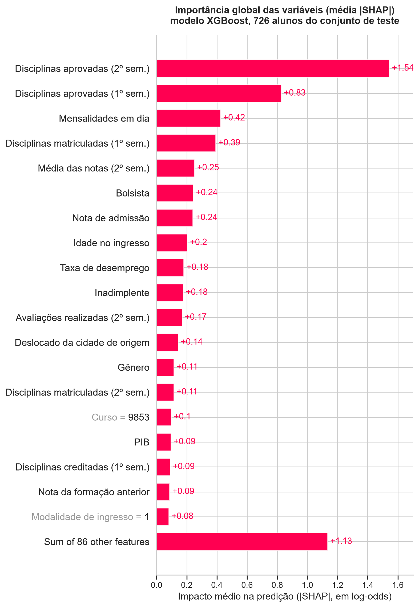
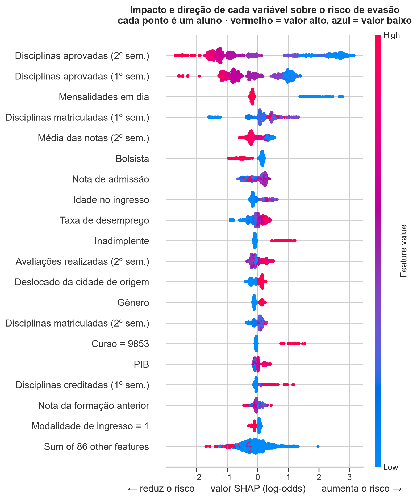
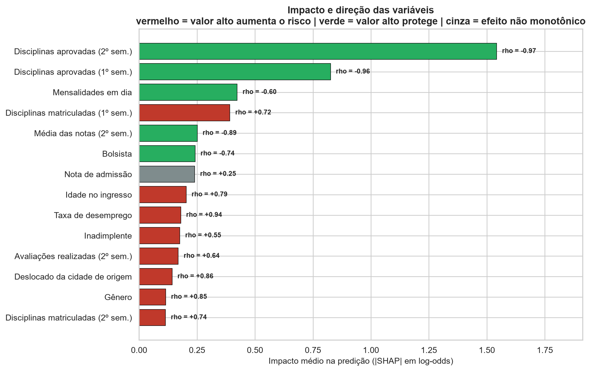
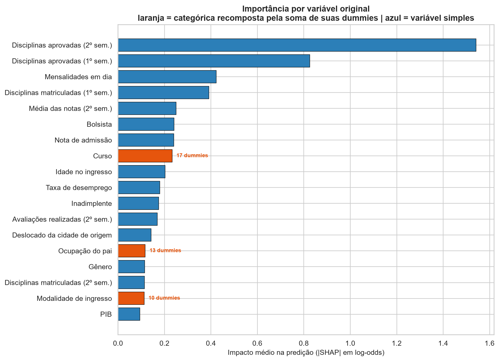
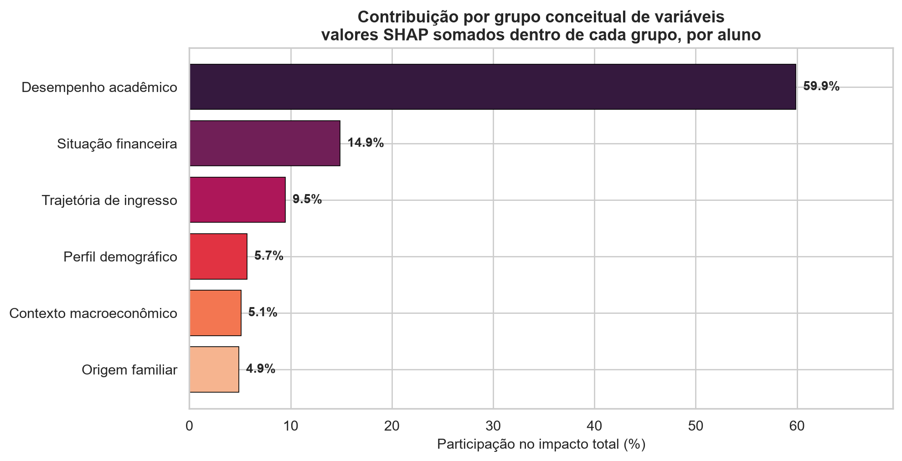
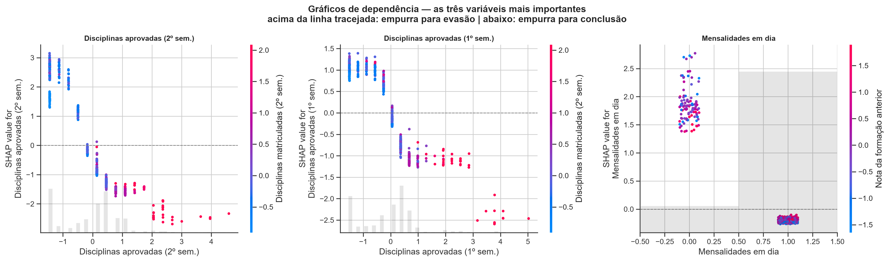
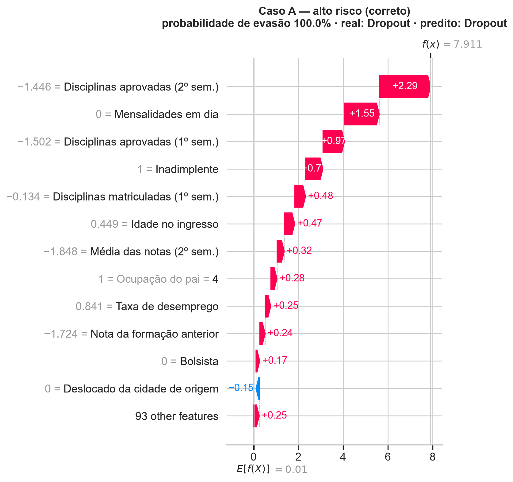
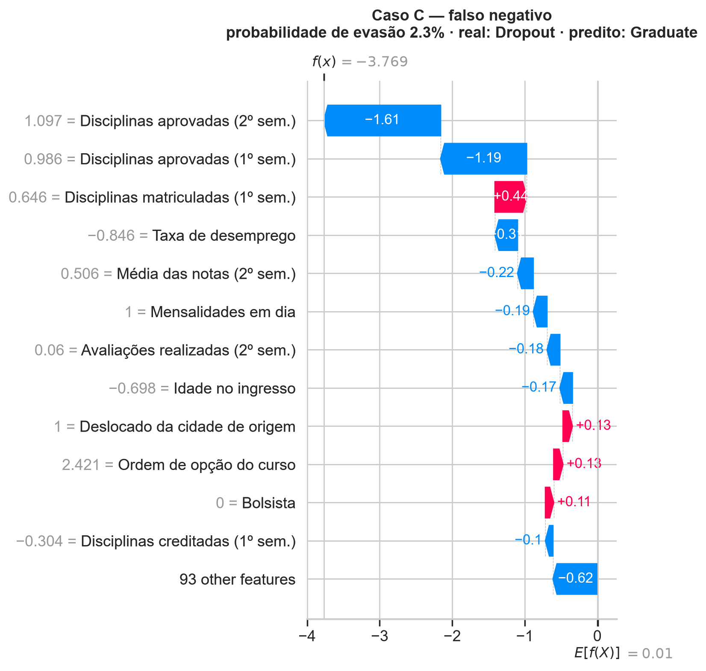
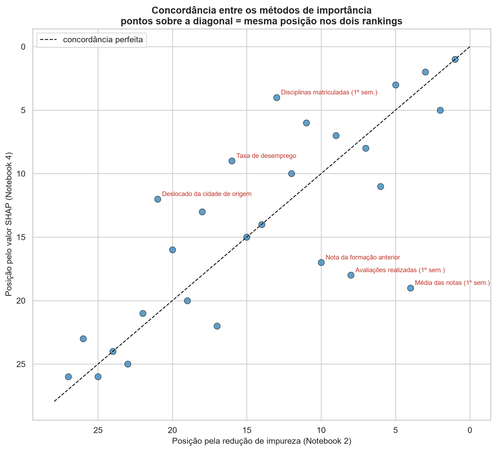

# 08 — Interpretabilidade com SHAP (Fase 5 do CRISP-DM)

> **Notebook:** `04_interpretabilidade_shap.ipynb` (53 células — 28 de código, 29 de markdown)
> **Entrada:** `modelos/melhor_modelo.joblib` (XGBoost) + `dados/X_test.csv`
> **Saídas:** 5 CSVs, valores SHAP completos em `.npz`, casos individuais em JSON, 13 figuras

---

## 1. Objetivo e justificativa

As fases anteriores responderam **quem** está em risco. Esta responde **por quê** — e é aqui que o
trabalho cumpre o "interpretável" do título.

### Por que a interpretabilidade não é um acessório

Um modelo que devolve apenas uma lista de nomes **não diz o que fazer**. Dois alunos com
probabilidade de evasão de 0,85:

- o primeiro sinalizado por **inadimplência e ausência de bolsa** → assistência estudantil;
- o segundo, por **reprovações com mensalidades em dia** → apoio pedagógico.

São intervenções diferentes, de setores diferentes, com custos diferentes. Sem explicação individual,
a coordenação recebe os dois na mesma lista e trata os dois do mesmo jeito.

### O argumento independente que a Fase 4 produziu

O Notebook 3 mostrou que Random Forest e XGBoost têm **métricas agregadas idênticas** e ainda assim
**discordam sobre 24 alunos**. Métricas agregadas resumem o placar, não a decisão individual. Quando o
produto é uma lista de nomes, **a explicação por aluno faz parte da avaliação do modelo**, não é um
adorno dela.

---

## 2. Fundamento e verificação

**SHAP** (Lundberg & Lee, 2017) importa da teoria dos jogos cooperativos o **valor de Shapley** — a
forma matematicamente única de repartir o resultado de um jogo entre os jogadores, respeitando quatro
axiomas (eficiência, simetria, linearidade, jogadores nulos). Aqui as variáveis são os jogadores e a
predição é o resultado a repartir.

Usou-se `shap.TreeExplainer` (**TreeSHAP**), que calcula os valores **exatos** em tempo polinomial
para modelos de árvore — sem amostragem, diferente do `KernelExplainer`.

### A propriedade central, verificada numericamente

```
predição(aluno) = valor base + Σ SHAP_i(aluno)
```

| Item | Valor |
|---|---|
| Valores calculados | 726 alunos × 105 features = **76.230 contribuições** |
| Valor base (log-odds) | **+0,0101** |
| Valor base (probabilidade) | **0,5025** |
| **Erro máximo da aditividade** | **3,8 × 10⁻⁶** |
| Erro máximo da recomposição por variável | 1,4 × 10⁻⁶ |
| Tolerância adotada | 1 × 10⁻⁴ |

O resíduo é da ordem da precisão de ponto flutuante de 32 bits (`float32`, eps ≈ 1,2 × 10⁻⁷): a
explicação é **exata, não aproximada**. Qualquer valor SHAP do notebook pode ser somado de volta à
predição original — é auditável.

> **Nota sobre o valor base.** Ele fica em 0,5025, e não na taxa real de evasão de 39,1%. Isso é
> consequência do treino balanceado por SMOTE, não um erro. O modelo parte de "meio a meio" e cada
> variável desloca a predição a partir daí.

### O que o SHAP corrige em relação à Fase 3

| Limitação da importância por impureza (NB2) | Como o SHAP resolve |
|---|---|
| Não informa **direção** — diz que "idade importa", não se idade alta aumenta ou reduz o risco | Valores têm sinal, por aluno |
| **Enviesada** para variáveis com muitos valores distintos | Axiomas de Shapley garantem atribuição justa independente de cardinalidade |

### A advertência que atravessa todo o documento

> **SHAP explica o modelo, não o mundo.** O valor mede **como o XGBoost usa a variável**, não como o
> fenômeno funciona. "Inadimplência empurra o risco para cima" significa *"o modelo aprendeu a associar
> inadimplência a evasão nestes dados"* — e **não** *"quitar a dívida reduz o risco em X"*.
>
> A segunda afirmação é causal e exigiria delineamento experimental. A distinção é mantida em todas as
> recomendações da §11.

### Escala

O XGBoost soma em **log-odds**, e os valores SHAP herdam essa escala. Um SHAP de +1,0 não é "+100% de
risco". Conversão: `P = 1 / (1 + e^(−log-odds))`. Os casos individuais são apresentados nas duas
escalas.

---

## 3. Importância global



| # | Variável | Impacto médio (SHAP absoluto) | % do total | % acumulado |
|---:|---|---:|---:|---:|
| 1 | Disciplinas aprovadas (2º sem.) | 1,5425 | **23,38** | 23,38 |
| 2 | Disciplinas aprovadas (1º sem.) | 0,8258 | 12,52 | 35,90 |
| 3 | Mensalidades em dia | 0,4232 | 6,42 | 42,32 |
| 4 | Disciplinas **matriculadas** (1º sem.) | 0,3918 | 5,94 | 48,26 |
| 5 | Média das notas (2º sem.) | 0,2509 | 3,80 | 52,06 |
| 6 | Bolsista | 0,2419 | 3,67 | 55,73 |
| 7 | Nota de admissão | 0,2401 | 3,64 | 59,37 |
| 8 | Idade no ingresso | 0,2032 | 3,08 | 62,45 |
| 9 | Taxa de desemprego | 0,1799 | 2,73 | 65,18 |
| 10 | Inadimplente | 0,1758 | 2,67 | 67,85 |

**Concentração:** top 3 = 42,3% · top 5 = 52,1% · top 10 = 67,8% · top 20 = 83,9%.

### Três observações

1. **A concentração no topo é extrema.** Uma única variável responde por **23,4%** de todo o impacto,
   contra 17,8% que a importância por impureza lhe atribuía. Na prática o modelo é muito mais simples
   do que suas 105 features fazem parecer — o que é boa notícia para a comunicação com a gestão.

2. **24 das 105 features têm impacto nulo** (SHAP absoluto abaixo de 10⁻⁶). Foram mantidas de propósito
   ([D-17](05-decisoes-metodologicas.md)), e o SHAP quantifica o custo dessa decisão: **zero**. Não
   fazer seleção agressiva foi inócuo, não prejudicial.

3. **A média das notas caiu para a 5ª posição** — nos Notebooks 1 e 2 estava entre as duas primeiras.
   Condicionado ao **número de aprovações**, saber a média agrega pouco: as duas variáveis carregam
   informação redundante e o modelo prefere a contagem. É o primeiro sinal de que efeito marginal e
   condicional divergem nesta base (§5).

---

## 4. Impacto e direção




Direção medida pela **correlação de Spearman entre o valor da variável e seu valor SHAP** — Spearman
e não Pearson porque interessa a consistência da *ordem* do efeito, não sua linearidade.

| Variável | Impacto | ρ valor × SHAP | Efeito de valor alto |
|---|---:|---:|---|
| Disciplinas aprovadas (2º sem.) | 1,5425 | −0,967 | **reduz** o risco |
| Disciplinas aprovadas (1º sem.) | 0,8258 | −0,956 | **reduz** |
| Mensalidades em dia | 0,4232 | −0,604 | **reduz** |
| Disciplinas matriculadas (1º sem.) | 0,3918 | **+0,718** | **aumenta** |
| Média das notas (2º sem.) | 0,2509 | −0,894 | reduz |
| Bolsista | 0,2419 | −0,739 | reduz |
| Nota de admissão | 0,2401 | +0,254 | **não monotônico** |
| Idade no ingresso | 0,2032 | +0,786 | aumenta |
| Taxa de desemprego | 0,1799 | **+0,943** | **aumenta** |
| Inadimplente | 0,1758 | +0,554 | aumenta |
| Avaliações realizadas (2º sem.) | 0,1692 | +0,639 | aumenta |
| Deslocado da cidade de origem | 0,1425 | **+0,861** | **aumenta** |

**Esta tabela é o resultado central do trabalho.** Ela converte o modelo em um conjunto de afirmações
verificáveis, cada uma com magnitude e direção — o que a importância por impureza não conseguia
entregar.

---

## 5. O achado principal: efeito condicional contra efeito marginal

Três variáveis receberam do SHAP uma direção **oposta** à que a análise descritiva do Notebook 1
indicava. Não é inconsistência: são duas perguntas diferentes.

| Pergunta | Como se mede | O que responde |
|---|---|---|
| **Efeito marginal** | Correlação simples, taxa por grupo | "Alunos com esta característica evadem mais?" |
| **Efeito condicional** | Valor SHAP | "**Dado tudo o mais que já sei do aluno**, isto agrega risco?" |

| Variável | Marginal | Condicional | Situação |
|---|---|---|---|
| Deslocado da cidade de origem | r = −0,126 — **protege**: 33,6% × 45,9% | ρ = **+0,861** | inversão de sinal |
| Disciplinas matriculadas (1º sem.) | r = −0,161 — protege | ρ = **+0,718**, 4ª mais importante | inversão de sinal |
| Taxa de desemprego | r = **−0,004** — nulo | ρ = **+0,943**, 9ª mais importante | efeito que **emerge** |

### 5.1 Deslocado da cidade de origem — inversão

Marginalmente, morar fora da cidade de origem *protege*: **33,6%** de evasão contra **45,9%** de quem
mora na própria cidade. Condicionalmente, o SHAP inverte o sinal.

A explicação plausível é **confundimento**: o aluno deslocado tende a ser o que passou em curso
concorrido, com nota de admissão maior e dedicação exclusiva. Uma vez que o modelo já conhece nota de
admissão, idade e desempenho, o que resta do "estar deslocado" é o **custo real de morar longe** — e
esse resíduo aumenta o risco.

### 5.2 Disciplinas matriculadas no 1º semestre — inversão

Marginalmente, matricular-se em mais disciplinas associa-se a *menos* evasão (r = −0,161):

| Disciplinas matriculadas | Taxa de evasão | n |
|---|---:|---:|
| até 5 | 57,1% | 944 |
| 6 | 38,0% | 1.594 |
| 7 | 30,0% | 546 |
| 8 ou mais | 20,7% | 546 |

Condicionalmente o SHAP aponta o contrário (ρ = +0,718), e a variável é a **4ª mais importante do
modelo**. A leitura é direta: **dado o número de disciplinas aprovadas**, matricular-se em muitas passa
a ser sinal de **sobrecarga e reprovação acumulada**.

> Matricular 8 e aprovar 6 é uma coisa; matricular 8 e aprovar 1 é outra completamente diferente. É
> exatamente essa razão implícita que o modelo aprendeu a usar — e que nenhuma análise univariada
> revelaria.

### 5.3 Taxa de desemprego — efeito que emerge do nada

O caso mais notável. Correlação marginal com a evasão: **−0,004**, indistinguível de zero. Ainda assim
é a **9ª variável mais importante**, com direção altamente consistente (ρ = +0,943).

O motivo aparece na tabela de quartis: a relação marginal tem **forma de U**, então a correlação linear
a mede como nula **por cancelamento**, não por ausência de relação.

| Taxa de desemprego | Taxa de evasão | n |
|---|---:|---:|
| 7,6 – 9,4 | 41,0% | 1.167 |
| 9,4 – 11,1 | 38,2% | 782 |
| 11,1 – 13,9 | 35,3% | 1.037 |
| 13,9 – 16,2 | 43,2% | 644 |

### 5.4 Por que isto importa para o TCC

Estes três casos são o argumento mais forte que o trabalho tem a favor da interpretabilidade por SHAP:

- **A análise descritiva do Notebook 1, isolada, levaria a conclusões erradas** sobre as três — inclusive
  à tentação de descartar a taxa de desemprego por correlação nula. A decisão
  [D-17](05-decisoes-metodologicas.md) — não fazer seleção de variáveis — está agora **justificada por
  evidência**, não apenas por princípio.
- **A importância por impureza do Notebook 2 acertaria a magnitude, mas não a direção** — e a direção é
  o que a gestão precisa para decidir o que fazer.
- **Advertência metodológica geral:** em um modelo com 105 variáveis correlacionadas, o efeito marginal
  de uma variável isolada e sua contribuição dentro do modelo são **grandezas diferentes**. Confundi-las
  é o erro mais comum na leitura de resultados de machine learning aplicado.

> **Ressalva obrigatória:** nada disso é causalidade. Que o desemprego contribua condicionalmente para a
> predição não significa que uma queda no desemprego reduziria a evasão em alguma magnitude estimável.

---

## 6. Recomposição das variáveis categóricas

O `OneHotEncoder` da Fase 3 transformou 9 nominais em 78 *dummies*, cada uma carregando apenas uma
fatia da informação original — e aparecendo com importância artificialmente baixa. A **linearidade** dos
valores de Shapley autoriza somá-las de volta; a operação é exata, não aproximada.



### Ganho de cada nominal ao ser recomposta

| Variável | Dummies | Melhor dummy | Recomposta | Ganho |
|---|---:|---:|---:|---:|
| Ocupação do pai | 13 | 0,0466 | 0,1174 | **2,5×** |
| Curso | 17 | 0,0965 | 0,2332 | **2,4×** |
| Escolaridade da mãe | 8 | 0,0303 | 0,0603 | 2,0× |
| Ocupação da mãe | 11 | 0,0492 | 0,0821 | 1,7× |
| Escolaridade do pai | 8 | 0,0363 | 0,0596 | 1,6× |
| Modalidade de ingresso | 10 | 0,0810 | 0,1128 | 1,4× |
| Formação anterior | 6 | 0,0868 | 0,0893 | 1,0× |
| Nacionalidade | 2 | 0,0012 | 0,0012 | 1,0× |
| Estado civil | 4 | 0,0000 | 0,0000 | impacto nulo |

Após a recomposição, **105 features → 35 variáveis originais**. `Curso` sobe para a **8ª posição**
(3,77% do impacto).

### Duas consequências

1. **Este é o ranking correto** quando a pergunta é *"quais fatores importam?"*. O ranking da §3
   responde a uma pergunta diferente — *"quais features do modelo importam?"* — e as duas não são a
   mesma coisa quando há one-hot no meio.
2. **Valida retroativamente a decisão [D-14](05-decisoes-metodologicas.md).** As nominais recompostas
   continuam abaixo do bloco acadêmico-financeiro, o que confirma que reduzir 200 categorias para 78
   dummies não custou capacidade explicativa.

> **Ressalva:** a soma informa a **magnitude** total da categórica, mas não uma direção única — não
> existe "valor alto de curso". Para essas variáveis a interpretação útil é por categoria específica.

### Contribuição por grupo conceitual



| # | Grupo | Features | Impacto médio | % do total |
|---:|---|---:|---:|---:|
| 1 | Desempenho acadêmico | 12 | 2,4089 | **59,9%** |
| 2 | Situação financeira | 3 | 0,5992 | **14,9%** |
| 3 | Trajetória de ingresso | 36 | 0,3809 | 9,5% |
| 4 | Perfil demográfico | 11 | 0,2292 | 5,7% |
| 5 | Contexto macroeconômico | 3 | 0,2066 | 5,1% |
| 6 | Origem familiar | 40 | 0,1960 | **4,9%** |

*Cobertura: 105 de 105 features classificadas.*

O contraste mais informativo está nos extremos: **desempenho acadêmico responde por 59,9% do impacto
com 12 features**, enquanto **origem familiar responde por 4,9% com 40 features** — a maior contagem de
todos os grupos, e o menor impacto.

---

## 7. Dependência e limiares operacionais



Os gráficos mostram **transições abruptas**, não rampas suaves — comportamento típico de modelos de
árvore. Neste problema isso tem significado substantivo: existe um ponto de ruptura a partir do qual o
modelo passa a tratar o aluno como caso de risco.

### Pontos de virada em unidades reais

Convertidos de volta pela inversão do `StandardScaler` — sem isso o limiar ("valor padronizado abaixo
de −0,175") não serve como gatilho operacional.

| Variável | Gatilho de alerta | SHAP no pior valor |
|---|---|---:|
| **Disciplinas aprovadas (2º sem.)** | ≤ **3** disciplinas | +2,43 com 0 aprovações |
| **Disciplinas aprovadas (1º sem.)** | ≤ **4** disciplinas | +1,04 |
| **Média das notas (2º sem.)** | ≤ **11** na escala 0–20 | +0,36 |
| **Idade no ingresso** | ≥ **23** anos | +0,51 com 25 anos |

Detalhamento das aprovações no 2º semestre:

| Aprovadas | n | SHAP médio | Direção |
|---:|---:|---:|---|
| 0 | 170 | **+2,428** | evasão |
| 1 | 26 | +2,621 | evasão |
| 2 | 18 | +2,242 | evasão |
| 3 | 37 | +1,161 | evasão |
| 4 | 52 | −0,172 | conclusão |
| 5 | 112 | −0,819 | conclusão |
| 6 | 160 | −1,267 | conclusão |
| 8 | 55 | −1,544 | conclusão |

### A assimetria entre risco e proteção

Note que o efeito de risco é **muito maior em magnitude** que o efeito protetor. No caso binário de
`Mensalidades em dia` isso fica explícito:

| Situação | SHAP médio |
|---|---:|
| Em atraso — valor 0 | **+1,858** |
| Em dia — valor 1 | −0,186 |

O efeito de risco é quase **dez vezes** o efeito protetor. O modelo aprendeu que **ir mal antecipa a
evasão, mas ir bem não garante a formatura** — coerente com a natureza do fenômeno.

Para a gestão, "aluno com até 3 aprovações no semestre" é um critério que qualquer secretaria consegue
monitorar; uma probabilidade calibrada, não.

---

## 8. Explicações individuais

Três casos escolhidos deliberadamente:

| Caso | Perfil | Prob. | Real | Predito |
|---|---|---:|---|---|
| **A** | Alto risco, correto | 1,000 | Dropout | Dropout |
| **B** | Baixo risco, correto | 0,004 | Graduate | Graduate |
| **C** | **Falso negativo** | 0,023 | **Dropout** | Graduate |



### Caso A — alto risco corretamente identificado

| SHAP | Fator |
|---:|---|
| +2,291 | Disciplinas aprovadas (2º sem.) |
| +1,553 | Mensalidades em dia |
| +0,966 | Disciplinas aprovadas (1º sem.) |
| +0,774 | Inadimplente |
| +0,484 | Disciplinas matriculadas (1º sem.) |

Perfil somando desempenho nulo e inadimplência — os dois blocos dominantes atuando na mesma direção.

### Caso B — baixo risco corretamente liberado

| SHAP | Fator |
|---:|---|
| −1,405 | Disciplinas aprovadas (2º sem.) |
| −0,560 | Bolsista |
| −0,554 | Disciplinas aprovadas (1º sem.) |
| −0,539 | Ocupação do pai = 6 |
| −0,419 | Curso = 9238 |

Mostra os fatores de **proteção**, não só de risco — inclusive o efeito da bolsa em um caso concreto.

### Caso C — o falso negativo



| SHAP | Fator |
|---:|---|
| −1,610 | Disciplinas aprovadas (2º sem.) |
| −1,185 | Disciplinas aprovadas (1º sem.) |
| **+0,436** | Disciplinas matriculadas (1º sem.) |
| −0,311 | Taxa de desemprego |
| −0,217 | Média das notas (2º sem.) |

Um aluno que **evadiu** e que o modelo classificou com confiança — probabilidade de apenas 0,023 — como
concluinte. É o erro mais custoso possível. A decomposição mostra por quê: o perfil é **dominado por
fatores protetores**. Nos indicadores que o modelo aprendeu a usar, o aluno parecia estar em situação
regular.

> ### A conclusão honesta
>
> Existe um **teto para o desempenho deste modelo** que não depende de algoritmo, hiperparâmetro ou
> volume de dados. Ele decorre de as 36 variáveis disponíveis **não conterem as causas de parte das
> evasões** — problemas de saúde, mudança de cidade, questões familiares, oferta de emprego, escolha de
> outro curso.
>
> Nenhum ajuste de modelagem recuperaria os **29 falsos negativos** desta partição — 44 em uma
> partição típica, pela [Verificação 2](10-significancia.md). Ampliar o conjunto de variáveis é a
> única via, e mesmo assim parcialmente.
>
> Isso deve constar na monografia como **limite intrínseco do problema**, não como deficiência do
> modelo. E tem consequência prática direta: o sistema deve ser apresentado à coordenação como
> **auxílio à priorização**, nunca como veredito. **Um aluno não sinalizado não é um aluno seguro.**

---


### O caso C é típico do grupo? A verificação agregada

Descrever um aluno e concluir que existe um teto intrínseco é inferência a partir de **n = 1**. A
objeção é legítima e foi testada: o perfil dos **29 falsos negativos** foi comparado ao dos evadidos
que o modelo **detectou** e ao dos formandos.

| Variável | Falsos negativos | Evadidos detectados | Formandos | Parece com |
|---|---:|---:|---:|---|
| Disciplinas aprovadas (2º sem.) | **6,24** | 1,23 | 6,10 | formando |
| Disciplinas aprovadas (1º sem.) | **6,76** | 1,82 | 6,12 | formando |
| Média das notas (2º sem.) | **12,37** | 5,00 | 12,55 | formando |
| Mensalidades em dia | **0,97** | 0,62 | 0,99 | formando |
| Inadimplente | **0,07** | 0,24 | 0,05 | formando |
| Idade no ingresso | 24,55 | 26,39 | 21,60 | evadido |
| Bolsista | 0,07 | 0,09 | 0,33 | evadido |

**Em 5 das 7 variáveis-chave o falso negativo médio está mais próximo do formando do que do evadido
detectado.** O caso C não é exceção: é retrato do grupo. Persistido em
`dados/perfil_falsos_negativos.csv`.

Duas variáveis fogem do padrão, e são informativas: os falsos negativos são **menos bolsistas** (7%
contra 33% dos formandos) e **mais velhos no ingresso** (24,6 contra 21,6 anos). Parecem formandos no
desempenho acadêmico e na situação financeira corrente, mas carregam marcadores demográficos de risco
que o modelo pondera pouco — corretamente, porque isoladamente eles predizem mal.

### Ressalva específica dos casos individuais

Esta ressalva é **distinta** da ressalva de partição aplicada aos números agregados, e não é coberta
por ela.

Os casos A, B e C são **alunos específicos da partição da semente 42** — índices 181, 101 e 543 —
escolhidos como o extremo de cada categoria. Devem ser apresentados como **ilustração de um perfil**,
nunca como "o aluno que o modelo não detecta".

**O perfil do grupo é estável.** Nas 10 sementes, os falsos negativos se parecem mais com formandos do
que com evadidos detectados em 5 a 7 das 7 variáveis, e a média de aprovações no 2º semestre fica entre
5,2 e 6,2 em todas elas.

### Existe um núcleo duro de alunos persistentemente não detectados

Repetindo o pipeline em 10 sementes, 216 alunos distintos foram falso negativo em ao menos uma
partição. Contar quantos foram errados **nas dez** não responde à pergunta: com teste de 20%, um aluno
aparece em cerca de 2 das 10 partições, de modo que "errado nas dez" é quase impossível **por
construção do split**, não por comportamento do modelo.

A medida correta é **condicional** — erros divididos pelas vezes em que o aluno foi efetivamente
testado como evadido:

| Taxa condicional de falso negativo | Alunos | % |
|---|---:|---:|
| Nunca errado (0%) | 398 | 80,7% |
| Baixa (0 < t ≤ 30%) | 4 | 0,8% |
| Intermediária (30–99%) | 23 | 4,7% |
| **Sempre errado (100%)** | **68** | **13,8%** |

*Base: 493 evadidos que apareceram no conjunto de teste ao menos 3 vezes nas 10 partições. Persistido
em `dados/taxa_condicional_falsos_negativos.csv`.*

**A distribuição é bimodal.** Não há gradiente de dificuldade: 80,7% nunca são errados, 13,8% são
errados sempre, e menos de 6% ocupam posições intermediárias. Erro aleatório produziria concentração em
torno da média, não dois polos.

**O teste que fecha o argumento.** Se o erro fosse ruído distribuído à taxa global de 15,6%,
esperar-se-iam **1,3** alunos com taxa condicional de 100%. Observam-se **68** — cerca de **54 vezes
mais**. Três deles apareceram no teste cinco vezes e não foram detectados em nenhuma.

**Conclusão.** O erro do modelo **não é ruído distribuído entre os evadidos**: concentra-se num
subconjunto identificável e estável. Existe um núcleo duro persistentemente não detectado, e é ele —
não a variação amostral — que sustenta a afirmação de teto intrínseco. A afirmação fica **mais forte**,
não mais fraca: o teto tem endereço.

**Para a monografia:** a conclusão sobre o teto intrínseco pode ser afirmada, porque se apoia no perfil
agregado e estável. A descrição do caso C deve ser apresentada como **ilustração de um perfil**, nunca
como "o aluno que o modelo não consegue detectar" — esse aluno, em outra partição, provavelmente seria
detectado.


## 9. Convergência entre os três métodos



O trabalho mediu importância por três caminhos independentes, com fundamentos matemáticos distintos:

| Par de métodos | ρ de Spearman |
|---|---:|
| Correlação (NB1) × impureza (NB2) | +0,753 |
| Impureza (NB2) × SHAP (NB4) | +0,774 |
| Correlação (NB1) × SHAP (NB4) | +0,697 |

### A leitura correta exige cuidado

**O que converge.** O **bloco dominante** é o mesmo nos três métodos — desempenho acadêmico inicial
primeiro, situação financeira em seguida. Essa é a conclusão substantiva do trabalho, e ela sobrevive a
três operacionalizações independentes. É isso que sustenta a defesa.

**O que não converge.** Um ρ de 0,70 a 0,77 está longe de 1,00: há **reordenação substancial** nas
posições individuais. E isso é esperado, não problemático — a §5 mostrou três variáveis cujo efeito
condicional contraria o marginal. Se os rankings concordassem perfeitamente, os três métodos seriam
redundantes e não haveria motivo para calcular SHAP.

> **Consequência para a redação:** afirmações sobre **blocos** — "desempenho acadêmico é o fator
> dominante" — são robustas. Afirmações sobre **posições específicas** — "a variável X é a 4ª mais
> importante" — são condicionais ao método e devem ser apresentadas como tal.

---

## 10. Confronto com a literatura

| Achado do SHAP | Literatura | Situação |
|---|---|---|
| Desempenho acadêmico inicial é o fator dominante — 59,9% | Tinto (1975, 1993): **integração acadêmica** como principal determinante da persistência | ✅ Confirma |
| Situação financeira em segundo plano, com efeito forte — 14,9% | Cabrera et al. (1992); Realinho et al. (2022) | ✅ Confirma |
| Bolsa tem efeito protetor relevante — ρ = −0,74 | Literatura sobre auxílio estudantil e permanência | ✅ Confirma |
| Idade maior no ingresso aumenta o risco — ρ = +0,79 | Estudante não tradicional acumula responsabilidades concorrentes | ✅ Confirma |
| **Taxa de desemprego aumenta o risco** — 9ª mais importante | Estudos apontam associação entre desemprego e evasão | ✅ **Confirma, mas só no condicional** |
| Escolaridade e ocupação dos pais com efeito **modesto** — 4,9% com 40 features | Frequentemente reportadas como determinantes fortes do capital cultural | ⚠️ Nuance |

### As duas observações que exigem explicação

**A taxa de desemprego confirma a literatura por um caminho que a análise descritiva não veria.** O
Notebook 1 havia registrado as macroeconômicas como provavelmente pouco informativas, dado que
descrevem o **ano de ingresso** e não o indivíduo. O SHAP corrige essa expectativa: correlação marginal
de −0,004, mas contribuição condicional a 9ª maior do modelo, com ρ = +0,943. **Controlando pelo perfil
individual, o contexto macroeconômico da coorte importa.**

A ressalva do Notebook 1 permanece válida em outro sentido, e fica nas limitações: com apenas 10 valores
distintos, a variável também funciona como identificador aproximado de coorte, e o efeito medido **não
generaliza para anos futuros** cujos valores sejam diferentes de todos os observados no treino.

**Escolaridade dos pais com efeito modesto.** A explicação plausível não é que o capital cultural não
importe, e sim que seu efeito é **mediado** pelo desempenho acadêmico: a escolaridade dos pais influencia
a preparação do aluno, que se manifesta nas notas e aprovações — e essas já estão no modelo. Quando o
mediador está presente, o preditor distal perde peso marginal. É um argumento a favor de **modelagem
causal explícita** como trabalho futuro.

---

## 11. Recomendações para a gestão acadêmica

Cada item indica **onde intervir** e, quando aplicável, o que seria necessário para verificar se a
intervenção funciona.

### R-1 · Monitorar aprovações por semestre como indicador primário

Fator dominante em todos os métodos. **Gatilho concreto: até 3 aprovações no 2º semestre** — SHAP de
+1,16 a +2,43 nessa faixa.

- **Ação:** relatório automático ao fim de cada semestre.
- **Custo:** baixo — o dado já existe no sistema acadêmico.
- **Ressalva:** indicador **tardio**. Quando dispara, o aluno já parou de estudar. Serve para priorizar,
  não para prevenir.

### R-2 · Tratar inadimplência como alerta acadêmico, não apenas financeiro

Evasão de **86,6%** entre alunos com mensalidades em atraso, contra 24,7% dos que estão em dia. No SHAP,
o atraso contribui com **+1,86** — quase dez vezes o efeito protetor da adimplência, que é de −0,19.

- **Ação:** integrar o sistema financeiro ao acadêmico, para que o atraso gere contato da coordenação e
  não apenas cobrança.
- **Custo:** baixo.
- **Ressalva causal:** a inadimplência pode ser **sintoma** da decisão de sair, não sua causa. Mesmo como
  sintoma precoce, o indicador é útil.

### R-3 · Ampliar e priorizar a concessão de bolsas

Bolsistas evadem a **12,2%** contra 38,7% dos não bolsistas. O SHAP confirma efeito protetor consistente,
com ρ = −0,74.

- **Ação:** priorizar a concessão para alunos que combinem os fatores de risco identificados.
- **Custo:** alto — envolve orçamento.
- **Ressalva:** há **viés de seleção provável** — bolsas costumam exigir desempenho mínimo, então
  bolsistas já são um grupo selecionado. **É o item que mais precisaria de estudo experimental** antes de
  sustentar decisão orçamentária.

### R-4 · Acompanhamento diferenciado para ingressantes mais velhos

**Gatilho: 23 anos ou mais no ingresso** — ponto em que o SHAP médio vira positivo.

- **Ação:** turmas noturnas, flexibilização de prazos, apoio a quem trabalha.
- **Custo:** médio.
- **Ressalva:** idade é **marcador, não causa**. O que provavelmente opera são as responsabilidades
  concorrentes. A intervenção deve mirar essas responsabilidades.

### R-5 · Usar a explicação individual para encaminhar ao setor correto

**A recomendação que só o SHAP viabiliza**, e a mais ligada ao objetivo do TCC. O alerta deve incluir os
três principais fatores do aluno, e o encaminhamento seguir o fator dominante:

| Fator dominante no SHAP | Encaminhamento |
|---|---|
| Inadimplência, ausência de bolsa | Assistência estudantil / setor financeiro |
| Reprovações, notas baixas | Apoio pedagógico / monitoria / tutoria |
| Poucas avaliações realizadas | Contato direto — possível abandono em curso |
| Idade, turno noturno | Orientação sobre flexibilização de carga |

- **Custo:** baixo — é o próprio produto do modelo.
- **Valor:** evita o desperdício de tratar todos os sinalizados da mesma forma.

### R-6 · Comunicar o sistema como priorização, nunca como veredito

Os **29 falsos negativos** desta partição — 44 numa partição típica — mostram que há evasões cujas
causas não estão nos dados.

- **Ação:** treinar a coordenação para tratar a lista como priorização de atenção limitada, mantendo os
  canais tradicionais de acolhimento ativos para quem não aparece nela.
- **Custo:** nulo.
- **Por que importa:** se o sistema for apresentado como definitivo, a primeira evasão não prevista
  destruirá sua credibilidade interna.

### R-7 · Calibrar o limiar conforme a capacidade de atendimento

Baixar o limiar de 0,50 para **0,30** reduz os evadidos não detectados de 29 para 12 — **17 alunos
resgatados** ao custo de 34 conversas adicionais. Ver [doc 04](04-modelagem.md), §10.

- **Custo:** nulo — é um parâmetro.
- **Observação:** decisão de **política acadêmica**, não de modelagem.

#### A hierarquia de decisão que esta recomendação implica

A análise de custo pareado do [doc 04](04-modelagem.md), §9, mostrou que **o limiar é um instrumento mais
potente que a escolha do algoritmo**. Isso estabelece uma ordem:

| Ordem | Decisão | Quem decide |
|---:|---|---|
| 1º | **Política de custo** — quantas convocações desnecessárias valem a pena para não perder um aluno? | A instituição |
| 2º | **Limiar de decisão** que implementa essa política | Derivado de 1, pela tabela de cenários |
| 3º | **Algoritmo** — só relevante se a política exigir recall acima de 0,96 | Técnico |

Duas evidências sustentam essa ordem:

- **O limiar 0,50 não é ótimo nem para o próprio modelo.** A Regressão Logística detecta 265 evadidos
  pagando 44 falsos alarmes nesse limiar, quando a sua própria curva alcança os mesmos 265 com apenas 40.
  É desempenho deixado na mesa por seguir uma convenção de biblioteca.
- **Com os limiares pareados, a diferença entre algoritmos é marginal.** O XGBoost detecta de +1 a +5
  evadidos a mais que a Regressão Logística no mesmo custo — menos que a variação induzida pela partição
  dos dados.

> **Ressalva importante:** um limiar localizado por busca no conjunto de teste é **ilustrativo do formato
> da curva**, não um valor a adotar em produção. O limiar operacional precisa ser escolhido por validação
> cruzada, sobre dados que não foram usados para avaliar o modelo.

---

## 12. Artefatos

| Arquivo | Conteúdo |
|---|---|
| `dados/shap_importancia_global.csv` | 105 features, impacto médio, % e % acumulado |
| `dados/shap_direcao_efeito.csv` | Top 15 com ρ e classificação da direção |
| `dados/shap_variaveis_recompostas.csv` | 35 variáveis originais, dummies somadas |
| `dados/shap_grupos_conceituais.csv` | 6 grupos, impacto e participação |
| `dados/shap_convergencia_metodos.csv` | Rankings dos três métodos, lado a lado |
| `dados/shap_valores_teste.npz` | Valores SHAP completos, 726 × 105, para reanálise |
| `dados/shap_casos_individuais.json` | Os três casos com seus fatores decisivos |

**Figuras 12 a 20** — 13 arquivos, incluindo waterfall e force plot dos três casos.

### Verificações automáticas

```
[OK] aditividade preservada
[OK] todas as 105 features explicadas
[OK] todos os 726 alunos explicados
[OK] rótulos em português sem duplicatas
[OK] recomposição preserva a soma
[OK] três casos individuais selecionados
```

---

## 13. Síntese da Fase 5

### Os cinco achados

1. **A hierarquia dos fatores se confirma por um terceiro método independente.** Correlação linear,
   redução de impureza e valores de Shapley convergem no bloco dominante. Uma conclusão que sobrevive a
   três operacionalizações distintas é substancialmente mais robusta.

2. **A direção do efeito agora é explícita e quantificada.** "Idade importa" passa a ser "idade a partir
   de 23 anos aumenta o risco, com magnitude X" — informação que uma coordenação consegue usar.

3. **A recomposição das categóricas corrige a hierarquia.** `Curso` sobe 2,4× e alcança a 8ª posição.
   É esse o ranking correto quando a pergunta é "quais fatores importam?".

4. **Três variáveis têm efeito condicional oposto ao marginal** — e isto não estava previsto.
   *Deslocado* e *matriculadas no 1º sem.* invertem de sinal; *taxa de desemprego* tem correlação
   marginal nula e é a 9ª mais importante. A análise descritiva isolada levaria a conclusões erradas
   sobre as três.

5. **O falso negativo revela um teto intrínseco.** Verificado no agregado, não só no caso C: os 29
   falsos negativos parecem formandos em 5 das 7 variáveis-chave. As causas de parte das evasões não estão nos dados;
   nenhum ajuste de modelagem recuperaria esses 29 alunos.

### O que a interpretabilidade acrescentou

A Fase 4 mostrou que Random Forest e XGBoost têm métricas idênticas e discordam sobre 24 alunos,
deixando registrado que métricas agregadas são insuficientes quando o uso é individual.

Esta fase entregou o que faltava: **cada aluno sinalizado vem acompanhado do motivo**, com contribuição
quantificada e auditável por variável. É isso que viabiliza a recomendação R-5, e é isso que separa uma
lista de nomes de um instrumento de gestão.

### Limitação central

> **SHAP explica o modelo, não o mundo.** Todos os valores medem como o XGBoost usa cada variável, não o
> efeito causal sobre a evasão. As recomendações da §11 identificam **onde intervir**; verificar **se a
> intervenção funciona** exigiria delineamento experimental — em especial no caso das bolsas (R-3), onde
> há viés de seleção provável.
>
> Confundir associação preditiva com efeito causal é o erro mais comum na aplicação de
> interpretabilidade a políticas públicas, e o mais fácil de a banca identificar.
