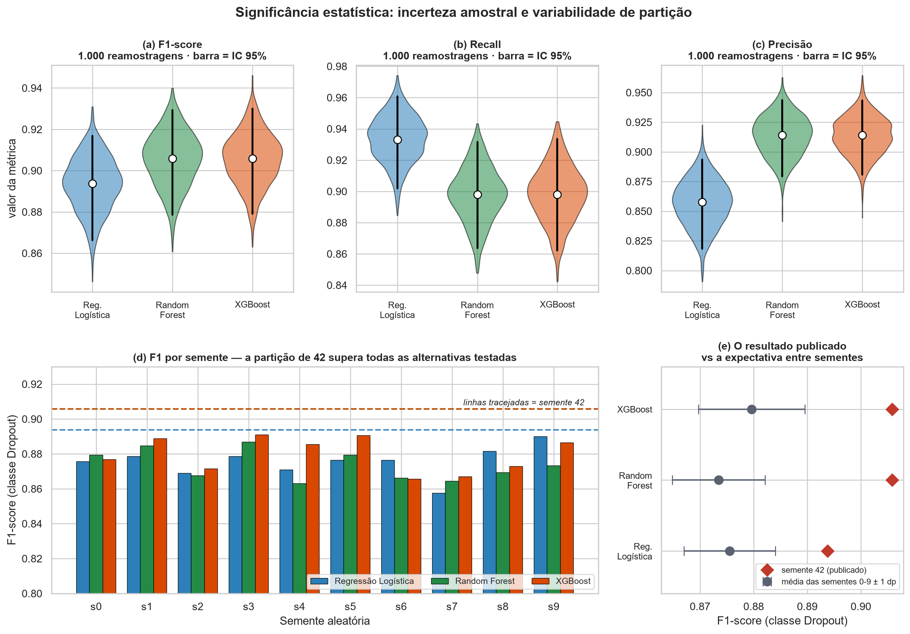

# 10 — Significância Estatística

> **Notebook:** `07_significancia.ipynb` (26 células)
> **Motivação:** fechar as limitações L-04, L-05, L-07 e L-12 de
> [`docs/07`](07-limitacoes-e-trabalhos-futuros.md) — todas decorrentes de as métricas finais virem de
> **uma única partição de teste**.
> **Saídas:** `bootstrap_metricas.csv`, `mcnemar_resultados.csv`, `variabilidade_sementes.csv`,
> `numeros_operacionais_semente.csv`, `figuras/23_intervalos_confianca.png`

---

## 1. As duas perguntas

**Pergunta 1 — a tese de equivalência se sustenta?** O trabalho afirma que os três modelos são
equivalentes na prática e que o vencedor saiu de um critério de desempate. Isso é defensável
estatisticamente, ou é leitura otimista de diferenças que na verdade são reais?

**Pergunta 2 — o resultado publicado é representativo?** `random_state=42` foi fixado *a priori*
([D-28](05-decisoes-metodologicas.md)). Aquela partição é típica, ou foi favorável por acaso?

Nada foi retreinado sem necessidade: o *bootstrap* e o McNemar reutilizam as predições dos modelos já
salvos. Só a §4 retreina, porque variar a semente exige refazer a partição.

---

## 2. *Bootstrap* do conjunto de teste

**Procedimento:** 1.000 reamostragens com reposição dos 726 alunos. Em cada uma, as métricas dos três
modelos são recalculadas sobre a **mesma** reamostragem, o que preserva o pareamento. IC de 95% pelos
percentis 2,5 e 97,5.



### 2.1 Intervalos de confiança de 95%

| Modelo | F1 observado | IC 95% do F1 | Largura |
|---|---:|---|---:|
| Regressão Logística | 0,8938 | [0,8663 — 0,9168] | 0,0505 |
| Random Forest | 0,9059 | [0,8786 — 0,9293] | 0,0507 |
| XGBoost | 0,9059 | [0,8791 — 0,9300] | 0,0509 |

| Modelo | Recall observado | IC 95% do recall | Precisão observada | IC 95% da precisão |
|---|---:|---|---:|---|
| Regressão Logística | 0,9331 | [0,9020 — 0,9607] | 0,8576 | [0,8185 — 0,8935] |
| Random Forest | 0,8979 | [0,8638 — 0,9315] | 0,9140 | [0,8794 — 0,9436] |
| XGBoost | 0,8979 | [0,8622 — 0,9336] | 0,9140 | [0,8809 — 0,9432] |

**Nenhum par de modelos tem intervalos disjuntos**, em nenhuma das três métricas.

### 2.2 Leitura

A largura do intervalo em F1 é de **≈ 0,051**, contra uma diferença de **0,012** entre o melhor e o
pior modelo. A incerteza amostral é **quatro vezes maior** que a diferença que se pretenderia medir.

A largura é praticamente idêntica nos três modelos, o que é esperado: ela decorre do tamanho da amostra
de teste (726 alunos), não das propriedades do modelo.

> **Cuidado com o que isso prova.** Sobreposição de intervalos de confiança é evidência *sugestiva* de
> equivalência, **não** um teste formal. Dois intervalos podem se sobrepor e a diferença pareada ainda
> ser significativa, porque o *bootstrap* marginal descarta a informação de que os modelos foram
> avaliados **nos mesmos alunos**. É essa informação que o McNemar usa — e o resultado da §3.2 mostra
> por que a distinção importa.

---

### 2.3 O PR-AUC também precisa de intervalo de confiança

O [doc 04](04-modelagem.md) usou **PR-AUC** como critério de desempate entre Random Forest e XGBoost. A
diferença observada é de apenas **0,0031** — menor que a diferença de F1 (0,012) que o *bootstrap* acima
já mostrou estar dentro da incerteza amostral. Afirmar que uma curva "domina" a outra sem testar
significância seria inconsistente com o padrão adotado no resto do documento.

| Modelo | PR-AUC observado | IC 95% | Largura |
|---|---:|---|---:|
| Regressão Logística | 0,9710 | [0,9587 — 0,9816] | 0,0229 |
| Random Forest | 0,9697 | [0,9567 — 0,9811] | 0,0244 |
| XGBoost | 0,9741 | [0,9623 — 0,9846] | 0,0223 |

**Nenhum par com intervalos disjuntos.** E a diferença **pareada** — calculada na mesma reamostragem, o
que preserva o pareamento:

| | |
|---|---|
| Diferença média (XGBoost − Reg. Logística) | **+0,0031** |
| IC 95% | **[−0,0027, +0,0093]** |
| Contém o zero? | **Sim** |
| P(XGBoost > Reg. Logística) nas reamostragens | 85,4% |

> **O PR-AUC não sustenta a palavra "domina".** A diferença não é estatisticamente significativa: 85,4%
> de probabilidade é sugestivo, não conclusivo ao nível de 5%.
>
> Isso **não invalida** seu uso como critério de desempate declarado — um desempate precisa ser objetivo e
> fixado de antemão, não estatisticamente significativo. Mas onde o trabalho usava o PR-AUC como evidência
> de superioridade, a formulação correta é que ele é **consistente com** uma leve vantagem do XGBoost, sem
> estabelecê-la.

---

## 3. Teste de McNemar

O McNemar é o teste apropriado para comparar dois classificadores no mesmo conjunto de teste. Ignora os
casos em que ambos acertam ou ambos erram e examina apenas os **discordantes**. Correção de continuidade
de Yates aplicada.

### 3.1 Escopo global — acurácia

| Par | Só A acerta | Só B acerta | Discordantes | χ² | p | Significativo |
|---|---:|---:|---:|---:|---:|---|
| Reg. Logística × Random Forest | 22 | 32 | 54 | 1,500 | 0,2207 | não |
| Reg. Logística × XGBoost | 21 | 31 | 52 | 1,558 | 0,2120 | não |
| Random Forest × XGBoost | 12 | 12 | 24 | 0,042 | 0,8383 | não |

**Nenhum par difere significativamente em acurácia.** A simetria perfeita entre Random Forest e XGBoost
— **12 contra 12** — é a explicação estatística do empate exato nas matrizes de confusão observado no
[doc 04](04-modelagem.md), §8.

### 3.2 Escopo restrito aos evadidos — testando o recall

O teste global mede **acurácia**, que trata os dois tipos de erro como equivalentes. Mas o trabalho
declara que falso negativo custa mais que falso positivo, e o [doc 04](04-modelagem.md), §9, documentou
que a Regressão Logística detecta 10 evadidos a mais que o XGBoost.

**Esse trade-off nunca havia sido testado.** Aplicar o McNemar restrito aos **284 alunos que realmente
evadiram** responde diretamente: entre os que evadiram, um modelo detecta significativamente mais?

| Par | Só A detecta | Só B detecta | p | Significativo |
|---|---:|---:|---:|---|
| **Reg. Logística × Random Forest** | **15** | 5 | **0,0442** | **sim** |
| **Reg. Logística × XGBoost** | **14** | 4 | **0,0339** | **sim** |
| Random Forest × XGBoost | 5 | 5 | 0,7518 | não |

### 3.3 Achado — a tese central precisa de uma qualificação

Os dois escopos dizem coisas diferentes, e a diferença é substantiva:

| Escopo | Resultado |
|---|---|
| Acurácia global | Nenhum par significativo (p entre 0,21 e 0,84) |
| Recall (só evadidos) | **Reg. Logística significativamente melhor** que os dois modelos de árvore |

A formulação anterior era *"os três modelos são equivalentes na prática"*. A formulação correta passa a
ser:

> Os três modelos são estatisticamente equivalentes **em acurácia global e em F1**. Mas a **Regressão
> Logística detecta significativamente mais evadidos** (p < 0,05) — e o recall da classe `Dropout` é
> justamente a métrica que o trabalho declara priorizar.

### Ressalva de escopo — o teste é condicional ao ponto de operação

O McNemar comparou os modelos **no limiar padrão de 0,50 para ambos**. O resultado é, portanto,
**condicional a esse ponto de operação específico**.

Isso importa porque 0,50 é convenção de biblioteca, e nele os dois modelos operam em **níveis de recall
diferentes** — a Regressão Logística em 0,933 e o XGBoost em 0,898. O teste não impede que o recall seja
igualado ajustando o limiar de um dos modelos; é exatamente o que a §9 do [doc 04](04-modelagem.md)
investiga, com a curva de custo exata de cada modelo.

**E a resposta é que, igualados os pontos de operação, a vantagem se inverte na faixa prática:** o
XGBoost detecta mais evadidos pelo mesmo custo em **31 de 31** pontos com recall ≤ 0,958. A vantagem da
Regressão Logística se restringe a uma banda estreita (recall 0,961–0,972) que exige convocar metade da
turma.

**Isso não invalida a escolha do XGBoost** — ao contrário, a reforça. As razões:

1. O critério declarado *antes* de ver os resultados foi **F1**, não recall isolado
   ([D-21](05-decisoes-metodologicas.md)) — e em F1 os intervalos se sobrepõem.
2. Recall isolado é trivialmente maximizável: "sempre `Dropout`" atinge recall 1,000 sinalizando todo
   mundo.
3. **Com os limiares pareados, o XGBoost é melhor ou equivalente em toda a faixa utilizável.** Apenas
   políticas que exigem recall próximo do teto favorecem o modelo linear.

**O que o teste estabelece, então?** Que a diferença de recall **no limiar padrão** é real e não fruto do
acaso. O que ele não estabelece — e a §9 do doc 04 esclarece — é que a Regressão Logística seja um modelo
melhor: a diferença é uma propriedade **do ponto de operação**, não do algoritmo.

---

## 4. Repetição com 10 sementes

O *bootstrap* mede a incerteza de **qual amostra de alunos** compõe o teste, com a partição fixa. Esta
seção mede a fonte mais grave: **qual partição treino/teste foi sorteada**.

### Procedimento

Para cada semente de 0 a 9, o pipeline completo é refeito: separação estratificada 80/20 → `StandardScaler`
+ `OneHotEncoder` ajustados no treino → SMOTE no treino → treino → avaliação.

**Hiperparâmetros mantidos fixos** nos valores da busca em grade original. Refazer o `GridSearchCV` a
cada semente multiplicaria o tempo por 10 sem responder à pergunta desta seção, que é sobre a
variabilidade da **partição e do SMOTE**.

A semente 42 entra na rodada com dois propósitos: validar a fidelidade da reconstrução e situar o
resultado publicado na distribuição.

### 4.1 Validação da reconstrução

| Modelo | F1 recalculado | F1 publicado | Confere |
|---|---:|---:|---|
| Regressão Logística | 0,8938 | 0,8938 | sim |
| Random Forest | 0,9059 | 0,9059 | sim |
| XGBoost | 0,9059 | 0,9059 | sim |

A reconstrução reproduz **exatamente** os valores publicados. A comparação entre sementes é, portanto,
legítima — não está medindo diferença de implementação.

### 4.2 Variabilidade entre as sementes 0 a 9

| Modelo | F1 médio | Desvio | Faixa | Recall médio |
|---|---:|---:|---|---:|
| XGBoost | **0,8796** | 0,0099 | [0,8656 — 0,8909] | 0,8437 |
| Regressão Logística | 0,8755 | 0,0085 | [0,8576 — 0,8901] | **0,8630** |
| Random Forest | 0,8735 | 0,0086 | [0,8630 — 0,8868] | 0,8349 |

### 4.3 Estabilidade do ranking

Contar em quantas sementes cada modelo lidera é mais informativo que ordenar médias:

| Métrica | Reg. Logística | Random Forest | XGBoost | Amplitude entre modelos | Desvio típico |
|---|---:|---:|---:|---:|---:|
| **F1** | 3/10 | 1/10 | **6/10** | 0,0062 | 0,0090 |
| **Recall** | **10/10** | 0/10 | 0/10 | 0,0282 | 0,0128 |

Esta tabela sintetiza tudo:

- **Em F1, a amplitude entre modelos (0,0062) é menor que o desvio induzido pela partição (0,0090).** A
  liderança do XGBoost em 6 de 10 sementes é consistente, mas a ordem entre Regressão Logística e Random
  Forest — que diferem por 0,002 — é **ruído**.
- **Em recall, a amplitude (0,0282) é mais que o dobro do desvio (0,0128), e a Regressão Logística lidera
  em 10 de 10 sementes.** A vantagem é robusta, reproduzindo por outro método o resultado significativo
  do McNemar da §3.2.

> Quando a diferença entre dois modelos é menor que a variação induzida pela partição, a ordem entre
> eles é acidente de amostragem. O que sobrevive à troca de semente é o que o trabalho pode afirmar.

### 4.4 Achado — a semente 42 produziu uma partição favorável

**Este é o resultado mais importante do notebook, e não estava previsto.**

| Modelo | Sementes 0–9 | Semente 42 | z | Supera |
|---|---|---:|---:|---:|
| Regressão Logística | 0,8755 ± 0,0085 | 0,8938 | **+2,14** | **10/10** |
| Random Forest | 0,8735 ± 0,0086 | 0,9059 | **+3,75** | **10/10** |
| XGBoost | 0,8796 ± 0,0099 | 0,9059 | **+2,64** | **10/10** |

A semente 42 supera **todas as 10 alternativas testadas**, nos três modelos. O F1 publicado do XGBoost
(0,9059) fica **acima do máximo** observado entre as sementes 0 a 9 (0,8909), a cerca de 2,6
desvios-padrão da média.

**Não houve escolha oportunista.** `random_state=42` é a convenção padrão da área, foi fixada *a priori*
em [D-28](05-decisoes-metodologicas.md) e nunca foi trocada em função de resultados. A validação da §4.1
confirma que a comparação é legítima.

**A consequência é uma correção de expectativa, não de método.** O F1 esperado em uma partição típica é
de aproximadamente **0,88**, não 0,906. O valor publicado permanece correto **para aquela partição** —
mas é uma estimativa otimista do desempenho fora da amostra.

É exatamente o que a limitação [L-04](07-limitacoes-e-trabalhos-futuros.md) antecipava ao registrar que
"as métricas carregam incerteza amostral não quantificada". Agora está quantificada, e a direção do viés
é conhecida.

**Nota de escala:** o desvio entre sementes (≈ 0,009 em F1) é cerca de **um quinto** da largura do
intervalo de *bootstrap* (≈ 0,051). A partição importa, mas importa menos que o tamanho da amostra de
teste.

---

### 4.5 Os números operacionais em duas versões

Esta seção existe porque as frases que vão para o resumo e a conclusão da monografia — *"de cada 100
alunos que evadem, o modelo identifica 90"*, *"29 evadidos não detectados"* — vinham da partição da
semente 42 **sem ressalva no mesmo parágrafo**. A descoberta do viés ficava isolada numa seção técnica.

Os valores abaixo usam as **matrizes de confusão reais** de cada execução, extraídas diretamente com
`confusion_matrix`. Antes de compará-las, o notebook **verifica** que o tamanho do teste e o número de
evadidos são idênticos em todas as sementes — condição necessária para comparar contagens absolutas, e
que não pode ser suposta:

```
valores distintos de n_teste     : [726]
valores distintos de n_positivos : [284]
-> CONSTANTES
```

| Métrica | Semente 42 (reportada) | Média das 10 sementes | Faixa (mín – máx) |
|---|---:|---:|---|
| F1 | 0,9059 | 0,8796 | 0,8656 – 0,8909 |
| Recall | 0,8979 | **0,8437** | 0,8239 – 0,8592 |
| Precisão | 0,9140 | 0,9191 | 0,8873 – 0,9412 |
| **Detectados de cada 100 evadidos** | **90** | **84** | 82 – 86 |
| **Acerto de cada 100 sinalizados** | **91** | **92** | 89 – 94 |
| Verdadeiros positivos | 255 | 240 | 234 – 244 |
| **Falsos negativos** | **29** | **44** | 40 – 50 |
| Falsos positivos | 24 | 21 | 15 – 31 |
| Alunos sinalizados | 279 | 261 | 253 – 275 |

> **Nota sobre a coluna "Média das 10 sementes".** Ela reporta a **média das métricas calculadas em cada
> execução individual**, não a métrica recalculada a partir das contagens médias. As duas quantidades são
> matematicamente diferentes para **as três métricas** — F1, recall e precisão —, porque todas são razões,
> e a média de razões não é a razão das médias:
>
> | Métrica | Média das métricas individuais | Recalculada das contagens médias |
> |---|---:|---:|
> | F1 | 0,8796 | 0,8798 |
> | Recall | 0,8437 | 240 / 284 = 0,8451 |
> | Precisão | 0,9191 | 240 / 261 = 0,9195 |
>
> Divergências da ordem de 0,001 a 0,002 são **esperadas**, não erro de cálculo. Reporta-se a média das
> métricas individuais porque é ela que descreve "o que se espera de uma execução típica".

### 4.6 Como reportar esses números na monografia

A coluna "semente 42" é **correta para aquela partição** e sustenta todos os resultados publicados. A
coluna "média das 10" é a melhor estimativa do que se esperaria numa partição qualquer. Reportar as duas
é mais informativo do que escolher uma.

**Duas formulações equivalentes**, conforme couber melhor no texto:

- *"De cada 100 alunos que evadem, o modelo identifica **90 nesta partição dos dados** — o valor típico
  esperado em outras partições é de **84** (faixa de 82 a 86)."*
- *"O modelo identifica entre 82 e 90 de cada 100 alunos que evadem, dependendo da partição, com **90** na
  partição usada neste trabalho."*

**E uma observação sobre a precisão.** Nesta verificação específica, a precisão **não apresentou o mesmo
viés otimista observado no recall** — a semente 42 (0,9140) fica inclusive um pouco abaixo da média das
dez (0,9191).

Isso é um achado **desta amostra, não uma propriedade estrutural do modelo**. Precisão e recall são
interdependentes através do mesmo limiar, e não há garantia de que a precisão seja sempre mais estável
entre partições. A ressalva de partição vale para os dois números; o que difere aqui é a **direção e a
magnitude** do desvio observado.

---

## 5. Sobre a validação cruzada não aninhada (L-07)

A L-07 aponta que a estimativa de desempenho da própria validação cruzada é otimista, porque a melhor de
243 configurações foi escolhida em parte pelo ruído favorável das dobras.

Este notebook **não executa** CV aninhada, e a razão é que ela responderia a uma pergunta já resolvida
por outro caminho: o número reportado como resultado do trabalho é o do **conjunto de teste**, que nunca
participou da seleção de hiperparâmetros e portanto não sofre desse viés.

O que a §4 acrescenta é mais relevante: o efeito dominante sobre a estimativa não é a seleção de
hiperparâmetros, mas **qual partição foi sorteada**. A CV aninhada corrigiria o viés menor e deixaria o
maior intacto.

**L-07 permanece registrada**, com esta qualificação: seu efeito é de **segunda ordem** frente ao da §4.

---

## 6. Síntese

| Procedimento | Resultado |
|---|---|
| *Bootstrap* (1.000 reamostragens) | **Todos os ICs se sobrepõem**. Largura ≈ 0,051 em F1 contra 0,012 de diferença entre modelos |
| McNemar global | **Nenhum par significativo** (p entre 0,21 e 0,84) |
| McNemar restrito aos evadidos | **Reg. Logística significativamente melhor**: p = 0,044 (vs RF) e p = 0,034 (vs XGBoost) |
| McNemar RF × XGBoost (evadidos) | 5 contra 5 — simetria perfeita (p = 0,75) |
| 10 sementes — F1 | XGBoost lidera 6/10; amplitude entre modelos < desvio da partição |
| 10 sementes — recall | Reg. Logística lidera **10/10**; amplitude 2,2× o desvio |
| Posição da semente 42 | **Supera 10/10** nos três modelos; z de +2,1 a +3,8 |

### O que muda nas conclusões

**1. A tese de equivalência se confirma — com qualificação.**

> Os três modelos são estatisticamente equivalentes em acurácia global e em F1. Mas a Regressão Logística
> detecta significativamente mais evadidos, o que eleva o trade-off do [doc 04](04-modelagem.md), §9, de
> observação a diferença estatisticamente estabelecida.

**2. O desempenho publicado é otimista, e a magnitude está quantificada.** F1 de 0,9059 vale para a
partição da semente 42; a expectativa típica é **≈ 0,88**. Deve constar na monografia — não como erro,
mas como a quantificação que a L-04 pedia.

**3. Quatro limitações mudam de status.**

| Limitação | Situação |
|---|---|
| L-04 — partição única sem IC | **Resolvida** — ICs de *bootstrap* reportados |
| L-05 — ausência de teste de significância | **Resolvida** — McNemar em dois escopos |
| L-07 — CV não aninhada | **Qualificada** — efeito de segunda ordem |
| L-12 — dependência de uma semente | **Resolvida** — 10 sementes, viés da semente 42 quantificado |

### Decisão registrada

**D-39 · Reportar o resultado da semente 42 com a expectativa entre sementes ao lado**

| | |
|---|---|
| **Alternativa rejeitada** | (a) Trocar para uma semente "média"; (b) reportar a média das 10 sementes como resultado principal |
| **Justificativa** | Trocar a semente após ver os resultados seria seleção oportunista — precisamente o que se quer evitar. A semente 42 foi fixada *a priori* (D-28) e seu resultado é correto para aquela partição. Reportar as duas informações lado a lado é honesto e mais informativo que qualquer uma isolada |
| **Risco / limitação** | O número de destaque (0,9059) é otimista; mitigado pela menção explícita da expectativa de ≈ 0,88 |
| **Onde** | `07_significancia.ipynb` §4 |
