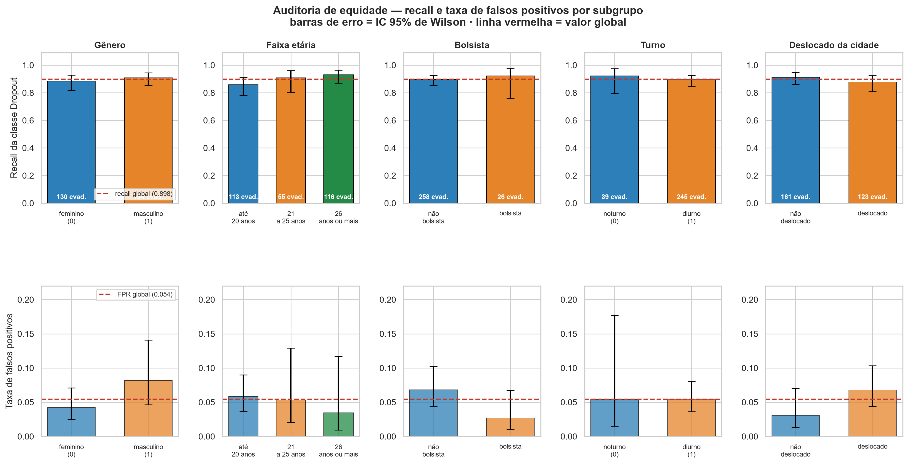

# 11 — Auditoria de Equidade Algorítmica

> **Notebook:** `08_auditoria_equidade.ipynb` (14 células)
> **Motivação:** fechar a limitação [L-11](07-limitacoes-e-trabalhos-futuros.md), registrada como "a
> mais importante entre as não previstas no escopo original".
> **Saídas:** `auditoria_equidade.csv`, `auditoria_equidade_resumo.csv`,
> `figuras/24_equidade_subgrupos.png`
> **Resultado:** nenhuma disparidade significativa; monitoramento contínuo passa a ser condição de uso.

---

## 1. Por que a auditoria é obrigatória neste trabalho

A Fase 5 confirmou que o modelo **usa** atributos sensíveis: gênero está entre os fatores ativos
(ρ = +0,55 na direção de risco) e variáveis socioeconômicas — bolsa, inadimplência, ocupação dos pais —
figuram entre os preditores relevantes.

Isso não é problema em si. O problema seria o modelo **errar mais para algum subgrupo**. E a razão é
específica ao produto deste trabalho:

> O sistema não gera uma nota nem uma estatística. Ele gera uma **lista de alunos que receberão apoio
> institucional**. Se o modelo detecta pior um subgrupo, esse subgrupo é sinalizado menos, recebe menos
> apoio, e o sistema **amplifica a desigualdade que deveria combater**.

## 2. Método

Nada foi retreinado: a auditoria usa as predições do `melhor_modelo.joblib` sobre o conjunto de teste
existente. Os atributos sensíveis em escala original vêm da reconstrução da partição — procedimento já
validado no [doc 10](10-significancia.md), §4.1, e reconferido aqui por asserção.

| Métrica | Pergunta que responde |
|---|---|
| **Recall** por subgrupo | Dos alunos deste grupo que evadiram, quantos o modelo detectou? |
| **FNR** (1 − recall) | Quantos evadidos deste grupo passaram sem alerta? |
| **FPR** | Quantos concluintes deste grupo foram convocados sem necessidade? |
| **Precisão** | Dos sinalizados deste grupo, quantos realmente evadiram? |

**Paridade de recall** exige recall semelhante entre subgrupos. ***Equalized odds*** é mais exigente:
requer paridade simultânea de recall **e** de FPR.

Cada subgrupo recebe **IC de Wilson**, e a comparação entre o de maior e o de menor recall passa por
teste de diferença de proporções. Sem isso, uma disparidade aparente poderia ser inteiramente ruído.

### Subgrupos examinados

| Variável | Subgrupos | n |
|---|---|---|
| Gênero | feminino / masculino | 438 / 288 |
| Faixa etária no ingresso | até 20 / 21–25 / 26+ | 422 / 130 / 174 |
| Bolsista | não / sim | 552 / 174 |
| Turno | noturno / diurno | 76 / 650 |
| Deslocado da cidade | não / sim | 323 / 403 |

Os cortes de idade seguem a distribuição real (mediana 20, 3º quartil 25).

---

## 3. Resultados

### 3.1 Recall, FPR e precisão por subgrupo

| Variável | Subgrupo | n | Evadidos | Taxa-base | Recall | IC 95% do recall | FNR | FPR | Precisão |
|---|---|---:|---:|---:|---:|---|---:|---:|---:|
| Gênero | feminino | 438 | 130 | 29,7% | 0,885 | [0,818 — 0,929] | 0,115 | 0,042 | 0,898 |
| Gênero | masculino | 288 | 154 | 53,5% | 0,909 | [0,853 — 0,945] | 0,091 | 0,082 | 0,927 |
| Faixa etária | **até 20 anos** | 422 | 113 | 26,8% | **0,858** | [0,782 — 0,911] | **0,142** | 0,058 | 0,844 |
| Faixa etária | 21 a 25 anos | 130 | 55 | 42,3% | 0,909 | [0,804 — 0,961] | 0,091 | 0,053 | 0,926 |
| Faixa etária | **26 anos ou mais** | 174 | 116 | 66,7% | **0,931** | [0,870 — 0,965] | 0,069 | 0,034 | 0,982 |
| Bolsista | não bolsista | 552 | 258 | 46,7% | 0,895 | [0,852 — 0,927] | 0,105 | 0,068 | 0,920 |
| Bolsista | bolsista | 174 | 26 | 14,9% | 0,923 | [0,759 — 0,979] | 0,077 | 0,027 | 0,857 |
| Turno | noturno | 76 | 39 | 51,3% | 0,923 | [0,797 — 0,973] | 0,077 | 0,054 | 0,947 |
| Turno | diurno | 650 | 245 | 37,7% | 0,894 | [0,849 — 0,927] | 0,106 | 0,054 | 0,909 |
| Deslocado | não deslocado | 323 | 161 | 49,8% | 0,913 | [0,859 — 0,947] | 0,087 | 0,031 | 0,967 |
| Deslocado | deslocado | 403 | 123 | 30,5% | 0,878 | [0,809 — 0,925] | 0,122 | 0,068 | 0,850 |

### 3.2 Disparidades e significância

| Variável | Menor recall | Maior recall | Disparidade de recall | Disparidade de FPR | p | Significativo |
|---|---|---|---:|---:|---:|---|
| **Faixa etária** | até 20: 0,858 | 26+: 0,931 | **7,3 pp** | 2,4 pp | 0,0720 | não |
| Deslocado | deslocado: 0,878 | não deslocado: 0,913 | 3,5 pp | 3,7 pp | 0,3433 | não |
| Turno | diurno: 0,894 | noturno: 0,923 | 2,9 pp | 0,0 pp | 0,5343 | não |
| Bolsista | não bolsista: 0,895 | bolsista: 0,923 | 2,8 pp | 4,1 pp | 0,6181 | não |
| Gênero | feminino: 0,885 | masculino: 0,909 | 2,4 pp | 4,0 pp | 0,5008 | não |

| Verificação | Resultado |
|---|---|
| Disparidades de recall acima de 10 pp | **nenhuma** |
| Disparidades estatisticamente significativas | **nenhuma** |
| Pares com ICs de recall disjuntos | **nenhum** |

---

## 4. Interpretação

### 4.1 Nenhuma disparidade significativa

Em nenhuma das cinco variáveis a diferença de recall entre subgrupos é estatisticamente significativa, e
em nenhuma há par com intervalos de confiança disjuntos. Todas as disparidades ficam abaixo do limite de
10 pontos percentuais adotado como critério de relevância.

Este é o resultado tranquilizador que **fortalece a recomendação de uso do modelo**: não há evidência de
que algum dos subgrupos examinados seja sistematicamente menos detectado.

### 4.2 A faixa etária é o ponto de monitoramento

A maior disparidade está na **idade no ingresso**: **7,3 pontos percentuais** de recall entre os alunos
de 26 anos ou mais (0,931) e os de até 20 anos (0,858), com **p = 0,072** — marginal, não significativa
a 5%.

Dois detalhes fazem dela a candidata a vigilância:

1. **A direção é monotônica.** O recall cresce consistentemente: até 20 → 21–25 → 26+. Padrões
   monotônicos são menos compatíveis com ruído do que oscilações.
2. **Acompanha a taxa-base.** A evasão real também cresce com a idade (26,8% → 42,3% → 66,7%). O modelo
   detecta melhor onde a evasão é mais frequente — comportamento esperado de um classificador, e não
   sinal de viés dirigido a um grupo.

**Implicação prática:** os alunos mais jovens são o grupo com maior risco de passar sem alerta. Como são
também o grupo mais numeroso (422 de 726) e o de menor taxa de evasão, o efeito absoluto é limitado —
mas é o ponto a vigiar em operação.

Note ainda que a **precisão** entre os alunos de até 20 anos é a menor da amostra (0,844 contra 0,982
dos alunos de 26+). Esse grupo recebe simultaneamente menos detecção e mais falsos alarmes — o que é
consistente com a explicação pela taxa-base, não com viés.

### 4.3 *Equalized odds*: as taxas de falsos positivos também se sobrepõem

Paridade de recall sozinha não basta. Sob *equalized odds*, exige-se paridade simultânea de recall **e**
de FPR — caso contrário um grupo poderia ser "bem detectado" apenas por ser convocado em excesso.

Duas variáveis mostram FPR relativamente diferente:

| Variável | FPR menor | FPR maior | Razão relativa |
|---|---|---|---|
| Gênero | feminino: 0,042 | masculino: 0,082 | ≈ 2× |
| Deslocado | não deslocado: 0,031 | deslocado: 0,068 | ≈ 2× |

Em termos **relativos** a diferença chama atenção; em termos **absolutos** é de 4 pontos percentuais, e
**os ICs se sobrepõem nos dois casos**. Homens e alunos deslocados são convocados com mais frequência
sem necessidade, mas dentro da margem de erro.

> Vale registrar uma diferença de contexto: para um sistema de **triagem para apoio**, um FPR mais alto
> significa *mais atenção oferecida*, não uma penalidade. A assimetria de custo aqui não é a de um
> sistema de crédito ou de justiça criminal, em que o falso positivo é punitivo. Isso não elimina a
> obrigação de monitorar — atenção institucional é recurso finito —, mas muda a leitura ética do erro.

### 4.4 A ressalva indispensável: poder estatístico limitado

Este é o ponto que impede a leitura de "está tudo bem".

O recall de cada subgrupo é calculado sobre os **evadidos daquele subgrupo**, e alguns grupos são
pequenos:

| Subgrupo | Evadidos | Largura do IC de recall |
|---|---:|---:|
| Bolsista · bolsista | 26 | **22,0 pp** |
| Turno · noturno | 39 | 17,7 pp |
| Faixa etária · 21 a 25 anos | 55 | 15,6 pp |
| Faixa etária · até 20 anos | 113 | 12,9 pp |
| Deslocado · deslocado | 123 | 11,6 pp |
| Gênero · feminino | 130 | 11,0 pp |
| Bolsista · não bolsista | 258 | 7,5 pp |

> **Uma disparidade real de 10 a 20 pontos percentuais em subgrupos pequenos seria indetectável com esta
> amostra.** A ausência de significância é **compatível** com equidade; não a comprova.
>
> Confundir "não detectei diferença" com "não há diferença" é o erro clássico de interpretação de teste
> de hipótese — e num contexto de alocação de apoio institucional, é um erro com consequências.

A conclusão desta auditoria, portanto, não é "o modelo é justo", e sim: **não há evidência de injustiça
nos subgrupos e no tamanho de amostra examinados, e o monitoramento precisa continuar em operação.**

---

## 5. Consequências para as recomendações

### R-5 revisada

A recomendação R-5 do [doc 08](08-interpretabilidade-shap.md) propõe usar a explicação SHAP para
encaminhar cada aluno ao setor adequado. Ela ganha a seguinte ressalva:

> **R-5 (revisada).** O uso do modelo para alocação de recursos deve ser acompanhado de **monitoramento
> contínuo de equidade**. A auditoria não encontrou disparidade significativa entre gênero, faixa
> etária, condição de bolsista, turno e deslocamento — mas a amostra de teste (726 alunos, com
> subgrupos de até 26 evadidos) tem poder limitado para detectar disparidades moderadas.
>
> Em operação real, com volume acumulado maior, as mesmas métricas devem ser recalculadas
> periodicamente. O `08_auditoria_equidade.ipynb` é reexecutável para esse fim: basta apontá-lo para o
> novo conjunto de avaliação.
>
> **Ponto de atenção prioritário:** o recall dos **alunos mais jovens** (até 20 anos) é o menor da
> amostra — 0,858 contra 0,931 dos alunos de 26 anos ou mais. A diferença não é significativa
> (p = 0,072), mas é a maior observada e tem direção monotônica.

### Atualização da limitação L-11

| | |
|---|---|
| **Antes** | "Ausência de análise de equidade algorítmica" — a limitação mais importante entre as não previstas |
| **Depois** | **Parcialmente resolvida.** Auditoria executada em cinco atributos, sem disparidade significativa. Permanecem como limitação o **poder estatístico insuficiente** para subgrupos pequenos e a **ausência de auditoria em atributos não examinados** — nacionalidade, escolaridade dos pais, curso |

---

## 6. Síntese

| Verificação | Resultado |
|---|---|
| Disparidades de recall acima de 10 pp | nenhuma |
| Disparidades estatisticamente significativas | nenhuma |
| Pares com ICs de recall disjuntos | nenhum |
| Maior disparidade de recall | faixa etária, **7,3 pp** (p = 0,072) |
| Maior disparidade de FPR | gênero e deslocamento, ≈ 4 pp (ICs sobrepostos) |
| Poder estatístico | **limitado** — subgrupos com 26 a 39 evadidos |

### As três afirmações que esta auditoria autoriza

1. **Não há evidência de disparidade** de recall ou de FPR entre gênero, faixa etária, condição de
   bolsista, turno e deslocamento, no conjunto de teste disponível.
2. **A faixa etária é o ponto de atenção**: alunos mais jovens têm o menor recall, com diferença
   marginal (p = 0,072) e direção monotônica que acompanha a taxa-base de evasão.
3. **A auditoria não comprova equidade** — apenas não encontra injustiça. O poder estatístico não
   permitiria detectar disparidades de 10 a 20 pp em subgrupos pequenos.

### Decisão registrada

**D-40 · Manter o modelo, com monitoramento de equidade como condição de uso**

| | |
|---|---|
| **Alternativa rejeitada** | (a) Declarar o modelo "auditado e justo"; (b) remover gênero e variáveis socioeconômicas para evitar o problema |
| **Justificativa** | A auditoria não encontrou disparidade significativa, o que não justifica intervenção. Remover atributos sensíveis é ineficaz — o modelo os reconstrói por correlação — e reduziria a capacidade de detectar justamente os alunos socioeconomicamente vulneráveis, que são a população de interesse. Mas o poder estatístico limitado impede declarar equidade |
| **Risco / limitação** | Disparidades de 10 a 20 pp em subgrupos pequenos permaneceriam indetectadas. Mitigado pela exigência de monitoramento contínuo (R-5 revisada) |
| **Onde** | `08_auditoria_equidade.ipynb` §4 |
