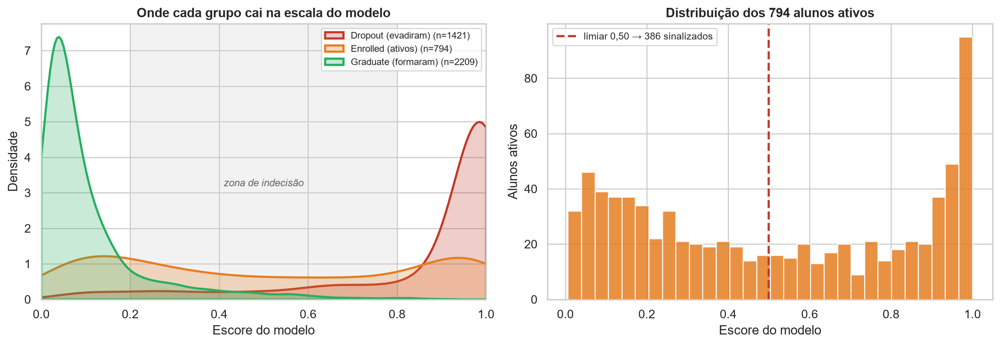
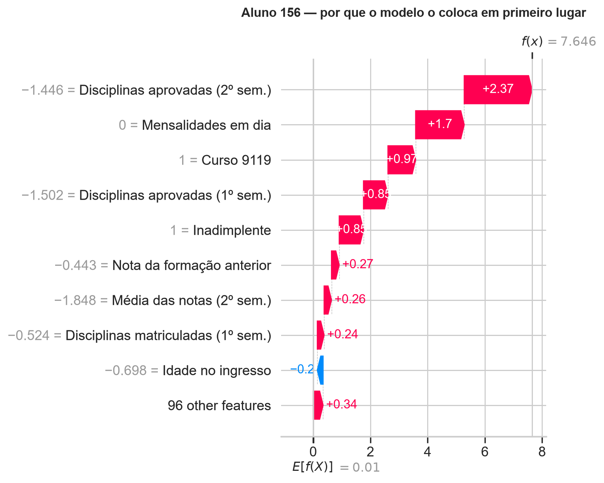

# 13 — Aplicação a Alunos Ativos

> **Notebook:** `09_aplicacao_alunos_ativos.ipynb` (32 células — 14 de código, 18 de markdown)
> **Entrada:** `dataset_limpo.csv`, `preprocessador.joblib`, `melhor_modelo.joblib`
> **Saídas:** `dados/alunos_ativos_priorizados.csv`, figuras 26 e 27

> **Convenção de partição.** Os números de desempenho citados por comparação vêm da partição da semente
> 42; em partições típicas o F1 é ≈ 0,88 e o modelo detecta 84 de cada 100 evadidos. Ver a
> [Verificação 2](10-significancia.md).

---

## 1. A pergunta

Dos alunos que ainda estão cursando, quais correm risco de evadir, por quê, e o que a instituição deve
fazer a respeito?

Este documento registra a aplicação do modelo aos **794 alunos com situação `Enrolled`** — exatamente a
classe removida na Fase 3 por não ter desfecho definido. É o uso pretendido do trabalho e, ao mesmo
tempo, o teste mais duro da sua limitação principal.

Os alunos ativos **nunca passaram pelo modelo**: foram removidos no Notebook 2, antes do split. Não há
vazamento.

---

## 2. A ressalva que condiciona tudo o que vem depois

Este é o cenário da limitação [L-01](07-limitacoes-e-trabalhos-futuros.md), a mais séria do trabalho.

| | População de **treino** | População de **aplicação** |
|---|---|---|
| Quem são | 3.630 alunos com desfecho definido | 794 alunos ativos, sem desfecho |
| O modelo aprendeu com eles? | Sim | **Não** |
| Sabemos se acertou? | Sim | **Não há como saber hoje** |

O modelo aprendeu a separar dois polos: quem se formou e quem evadiu. Os alunos ativos não são nenhum
dos dois — ainda. O escore produzido para eles responde a **"este aluno se parece com quem evadiu?"**,
e não a "qual a probabilidade de este aluno evadir".

A distinção não é preciosismo: a seção 3 mostra que ela tem consequência numérica direta, e a seção 4
mostra que ela invalida o limiar de decisão herdado das fases anteriores.

**Nenhum número deste documento foi validado contra desfechos reais**, porque esses desfechos ainda não
existem.

---

## 3. O achado central — os alunos ativos vivem na zona de indecisão

### Tabela 13.1 — Distribuição do escore por situação

| Grupo | n | Escore mediano | % na zona 0,2–0,8 |
|---|---:|---:|---:|
| Dropout — evadiram | 1.421 | 0,984 | 17,5% |
| **Enrolled — ainda cursando** | **794** | **0,480** | **42,4%** |
| Graduate — formaram | 2.209 | 0,058 | 13,1% |

Os alunos concluídos ficam nos extremos. **Os ativos ficam no meio**, com mediana próxima de 0,5 e uma
fração muito maior dentro da zona de indecisão.

Não é defeito do modelo: é consequência direta de ele nunca ter visto essa população. Os escores dos
concluídos são, além disso, otimistas — parte deles esteve no treino. A separação real seria menor, o
que não altera o que importa aqui: **os ativos estão sistematicamente mais próximos da fronteira do que
qualquer grupo que o modelo aprendeu.**

**Consequência:** o escore ordena bem, mas não deve ser lido como probabilidade para esta população.

---

## 4. O limiar 0,50 não pode ser transplantado

### Tabela 13.2 — Sinalizados por limiar, entre os 794 ativos

| Limiar | Sinalizados | % dos ativos |
|---:|---:|---:|
| 0,30 | 494 | 62,2% |
| 0,40 | 436 | 54,9% |
| **0,50** | **386** | **48,6%** |
| 0,60 | 336 | 42,3% |
| 0,70 | 286 | 36,0% |
| 0,80 | 240 | 30,2% |
| 0,90 | 181 | 22,8% |

Sinalizar quase metade dos alunos ativos não é política de intervenção — é uma lista que nenhuma
coordenação atende, e que por isso não seria atendida.

Isso reforça, com dados novos, o que a §9 do [doc 04](04-modelagem.md) já havia estabelecido: **o
limiar é decisão institucional, não propriedade do modelo.**

### A alternativa: partir da capacidade

### Tabela 13.3 — Escore de corte por capacidade de atendimento

| Capacidade | Escore de corte |
|---:|---:|
| 25 alunos | 0,994 |
| 50 | 0,988 |
| 100 | 0,966 |
| 150 | 0,929 |
| 200 | 0,870 |

Com 50 vagas de monitoria, o corte natural é o escore do 50º aluno. Nenhum limiar precisa de
justificativa teórica — ele decorre do orçamento.

---

## 5. A lista priorizada

O escore diz **quem**. O SHAP diz **por quê**, e é isso que transforma a lista em encaminhamento.
Aditividade conferida: erro máximo 3,34 × 10⁻⁶.

### Tabela 13.4 — Distribuição por faixa de risco

| Faixa | Alunos | % |
|---|---:|---:|
| Muito alto (≥ 0,90) | 181 | 22,8% |
| Alto (0,70–0,90) | 105 | 13,2% |
| Moderado (0,40–0,70) | 150 | 18,9% |
| Baixo (< 0,40) | 358 | 45,1% |

### Tabela 13.5 — Área de encaminhamento pelo fator dominante

| Área | Todos os 794 | 100 de maior risco |
|---|---:|---:|
| Pedagógico | 451 | 95 |
| Acadêmico | 190 | — |
| Financeiro | 75 | 5 |
| Contato direto | 43 | — |
| Análise individual | 35 | — |

A composição muda com a severidade, e a leitura é direta: entre os de maior risco o encaminhamento é
quase todo pedagógico, enquanto o bloco financeiro se distribui ao longo da lista. Parar de aprovar
disciplinas é o sinal mais tardio e mais forte; a inadimplência aparece antes e nem sempre leva à
evasão.

**442 alunos (55,7%) têm fatores de risco em mais de uma área** — as combinações mais frequentes são
Pedagógico + Acadêmico (142), Pedagógico + Contato (70) e Pedagógico + Financeiro (64). São os casos que
mais escapam de fluxos institucionais, porque cada setor tende a tratá-los como caso do outro.

---

## 6. Um caso individual

O aluno de prioridade 1 tem 18 anos, **zero disciplinas aprovadas em dois semestres**, nota zero,
inadimplente. Decomposição SHAP: aprovadas no 2º semestre empurra **+2,37** em log-odds, mensalidades
+1,70, inadimplência +0,85.

> **Como ler o waterfall.** Os números à esquerda são valores **padronizados**, mesma convenção da
> figura 18. Por isso "−1,446" aparece onde o valor real é zero.

> **Ressalva dos casos individuais.** Como no [doc 08](08-interpretabilidade-shap.md), este é um aluno
> específico, apresentado como ilustração de perfil.

---

## 7. Como usar, e como não usar

| Uso | Adequado? |
|---|---|
| Ordenar alunos por prioridade de atenção | **Sim** — é para isso que serve |
| Definir quantos convocar a partir da capacidade | **Sim** — seção 4 |
| Identificar o setor de encaminhamento | **Sim** — seção 5 |
| Afirmar "este aluno tem 92% de chance de evadir" | **Não** — escore não calibrado nesta população |
| Aplicar o limiar 0,50 herdado das fases anteriores | **Não** — sinalizaria 48,6% dos ativos |
| Decisão automática sem revisão humana | **Não** — nenhum desfecho foi verificado |

---

## 8. Como validar de verdade

Registrar a lista hoje e conferir em dois semestres quem de fato evadiu. Isso converte os 794 alunos em
**conjunto de teste real** e transforma a L-01 de limitação em resultado mensurado — é o caminho
descrito em [TF-01](07-limitacoes-e-trabalhos-futuros.md).

---

## 9. Artefatos

| Arquivo | Conteúdo |
|---|---|
| `dados/alunos_ativos_priorizados.csv` | 794 linhas: prioridade, escore, faixa, área, ação, três fatores. Codificado em `utf-8-sig` para abrir no Excel com acentuação correta |
| `figuras/26_alunos_ativos_distribuicao.png` | Onde cada grupo cai na escala do modelo |
| `figuras/27_aluno_ativo_waterfall.png` | Decomposição do aluno de maior risco |

A coluna `aluno` é o índice da linha em `dataset_limpo.csv`. Num sistema real seria a matrícula — o
dataset do UCI é anonimizado e não a contém.
